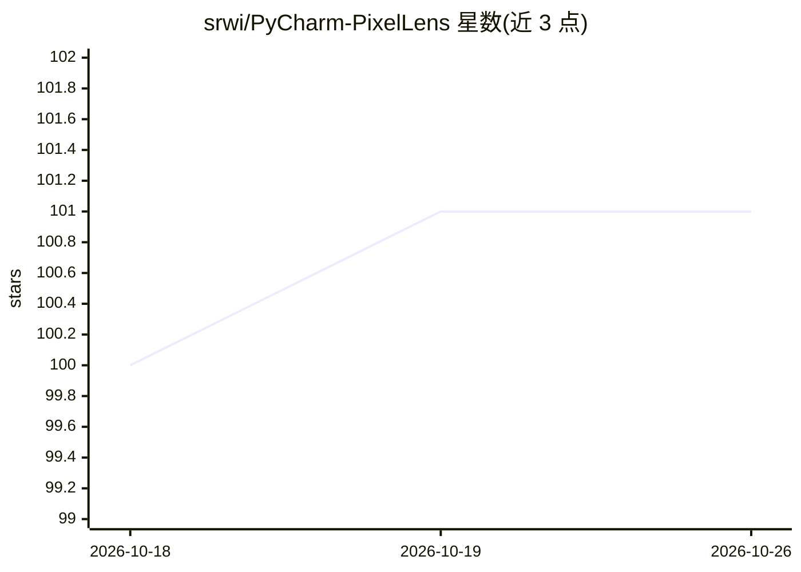

# srwi/PyCharm-PixelLens

⭐ 101 · Kotlin · GPL-3.0 · 推送 2026-10-02 · [GitHub](https://github.com/srwi/PyCharm-PixelLens) · [官网](https://plugins.jetbrains.com/plugin/25039-pixellens) · 个人维护

**PyCharm 调试图像可视化插件：查看多维数组为图像**

JetBrains Marketplace 分发的 PyCharm 插件，在调试器中右键将 NumPy、OpenCV、PyTorch、TensorFlow、JAX、PIL 的变量以图像形式查看。支持 1D/2D/3D/4D 数据显示，可按第四维查看整个批次或单个通道，提供数值归一化与 Viridis 配色、CHW/HWC 维度转置、RGB/BGR 通道反转，以及保存/复制图像。安装途径为 IDE 内插件市场搜索或从磁盘手动安装插件包。GPLv3 许可。

## 筛选速览

| 维度 | 判定 | 备注 |
|---|---|---|
| AI 角色 | `ai-ecosystem` | LLM/agent 周边工具 |
| 许可风险 | `viral` | GPL-3.0 |
| 部署形态 | `None` |  |
| 模型依赖 | — | README 未给出锁定关系 |
| 硬件要求 | — | 无带数字的原话,不猜 |
| 安装摩擦 | `low` | 无编译、无系统依赖或容器化 |
| 成熟度 | — | 结构信号不足 |

## 能力要点

- 右键调试变量即可查看 NumPy/PyTorch/TensorFlow/JAX/PIL 数据为图像
- 支持 1D-4D 数据，可查看整个批次或单个通道
- 归一化与 Viridis 配色、CHW/HWC 转置、RGB/BGR 通道反转
- 保存或复制显示的图像

## 适用场景

- 调试计算机视觉或深度学习模型时直接查看张量数据
- 检查训练批次数据与各通道内容
- 对比转置或通道反转后的数据效果

## 场景标签

`图像视频处理` · 领域:感知与多模态

## 证据(README 行号)

> L6: PixelLens is a free and fully open source PyCharm plugin designed to enhance the image visualization capabilities wh
> L12: - View NumPy, OpenCV, PyTorch, TensorFlow, JAX and Pillow (PIL) data as image

## 星数曲线

2026-10-18 100 → 2026-10-26 101（+1）

---
*卡片 v1 · prompt 1.4 · 生成 2026-10-23 · 置信度 high · 依据 README sha `afcfbc76da17` · [字段定义](../../DATASET.md)*
