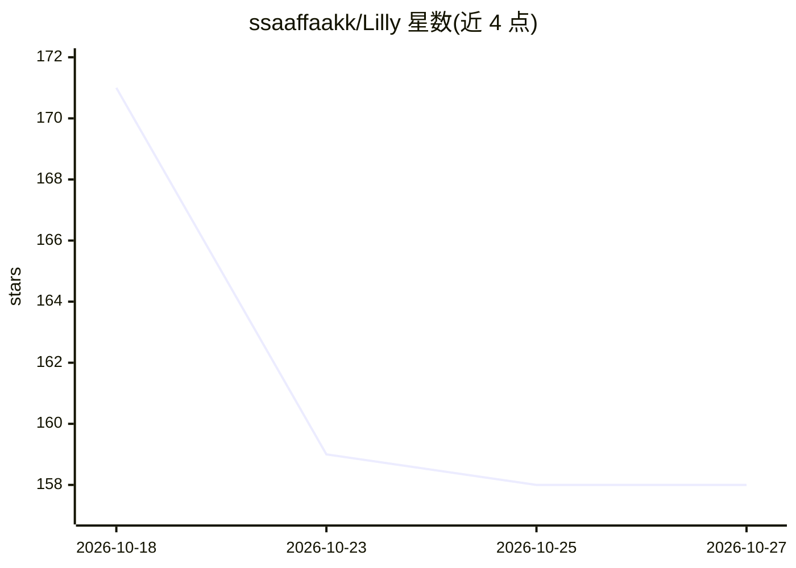

# ssaaffaakk/Lilly

⭐ 158 · Python · MIT · 推送 2026-10-14 · [GitHub](https://github.com/ssaaffaakk/Lilly) · [官网](https://github.com/ssaaffaakk/Lilly) · 个人维护

**离线波斯尼亚语–英语双向翻译助手：打字/语音/拍照输入**

个人开发者构建的离线波斯尼亚语–英语翻译应用：支持文本输入、语音识别、拍照 OCR 三种输入方式，双向翻译并可朗读输出；FastAPI 服务提供 translate/reply/speech/photo/document 等 API。模型为 OPUS-MT 微调（CTranslate2 int8）加 whisper-large-v3 与 PP-OCRv6 组合，模型加载完成后不再访问网络。附 Hugging Face Space 在线演示与可下载权重；README 公布留出集指标（翻译 43.25 BLEU）与失败实验。波斯尼亚语语音为区域 Piper 声音，非原生。

## 筛选速览

| 维度 | 判定 | 备注 |
|---|---|---|
| AI 角色 | `ai-native` | 本体是模型或模型工具 |
| 许可风险 | `permissive` | MIT |
| 部署形态 | `library` | 以包/库形式分发 |
| 模型依赖 | — | README 未给出锁定关系 |
| 硬件要求 | — | 无带数字的原话,不猜 |
| 安装摩擦 | `low` | 无编译、无系统依赖或容器化 |
| 成熟度 | — | 结构信号不足 |

## 能力要点

- 打字/语音/拍照三种输入的双向翻译，附 9 个 HTTP API 端点
- 完全离线运行：模型加载后不再访问网络
- 基于 OPUS-MT LoRA 微调（CTranslate2 int8）与 whisper-large-v3、PP-OCRv6
- 公布留出集评测结果与失败实验，翻译 43.25 BLEU / 68.10 chrF2

## 适用场景

- 在不懂波斯尼亚语的课堂或工作场合实时翻译对话与标牌
- 离线环境下的波斯尼亚语–英语文本、语音、图片翻译
- 翻译 .docx / .pdf 文档内容

## 场景标签

 · 领域:语言翻译/语音与视觉识别

## 证据(README 行号)

> L3:  An offline Bosnian–English translator you can type, talk, photograph, and hear back.
> L40: |**Translate** · Bosnian → English|**43.25 BLEU / 68.10 chrF2**, 0 leaked tags|1,012 held-out FLORES-200 devtest se
> L202: Lilly is a bundle, not a new architecture. The translator and the listener are

## 星数曲线

2026-10-18 171 → 2026-10-27 158（-13）

---
*卡片 v1 · prompt 1.4 · 生成 2026-10-22 · 置信度 mid · 依据 README sha `6ff65846775b` · [字段定义](../../DATASET.md)*
