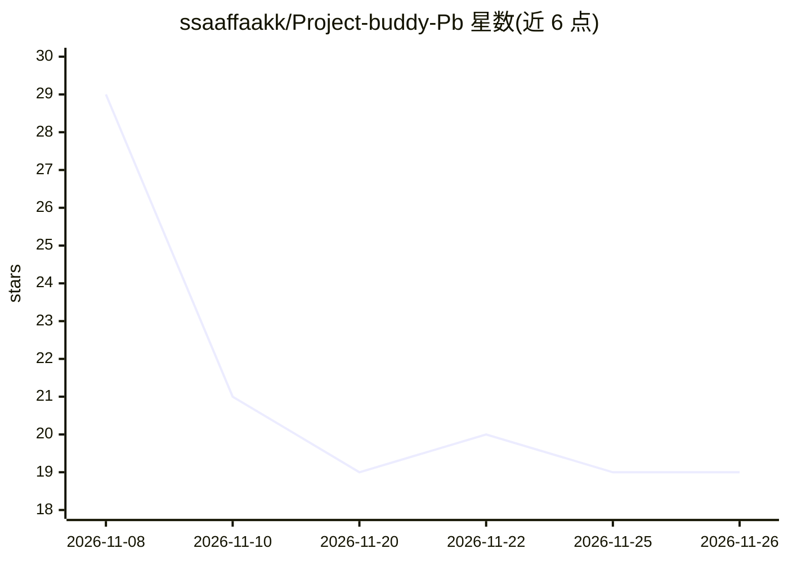

# ssaaffaakk/Project-buddy-Pb

⭐ 19 · HTML · MIT · 推送 2026-10-27 · [GitHub](https://github.com/ssaaffaakk/Project-buddy-Pb) · [官网](https://project-buddy-pb.onrender.com) · 个人维护

**面向大学生的组队平台：语义匹配队友与项目、信誉体系、RAG 助手**

ProjectBuddy 是面向大学生的项目组队 Web 平台，基于 Flask + PostgreSQL + Socket.IO。功能包括：项目发布与语义搜索、推荐技能匹配的队友（含申请人契合度评分）、每项目看板与实时聊天、学习小组（实时聊天/WebRTC 语音房）、测验生成与 Whisper 会议纪要、完成后互评与技能背书和徽章的信誉系统、教师团队健康面板。AI 助手经 Groq API（可回退 Anthropic 再回退内置 mock）接入，RAG 基于站内数据，含工具调用与确定性评测。另有 Celery 任务队列、ELT 数据仓库、MLflow 训练追踪与 Prometheus/Grafana 观测栈。本地从源码运行，默认数据库为 SQLite。

## 筛选速览

| 维度 | 判定 | 备注 |
|---|---|---|
| AI 角色 | `ai-enhanced` | 去掉 AI 部分产品仍成立 |
| 许可风险 | `permissive` | MIT |
| 部署形态 | `self-host` | docker 或自建部署 |
| 模型依赖 | locked-api |  |
| 硬件要求 | — | 无带数字的原话,不猜 |
| 安装摩擦 | `low` | 无编译、无系统依赖或容器化 |
| 成熟度 | — | 结构信号不足 |

## 能力要点

- 语义匹配推荐项目与队友，含可解释匹配理由与申请人契合度评分
- RAG 助手基于站内实时数据回答，支持工具调用并有确定性评测与 CI 测试
- 信誉系统：项目完成触发互评、技能背书与徽章，公开个人主页展示
-  logistic 回归 + LSA 双塔推荐器，含 A/B 实验、公开模型卡与每周再训练

## 适用场景

- 找有技能记录和信誉背书的项目队友，避免组队踩坑
- 在项目和学习小组中协作：看板、实时聊天、语音房、共享笔记
- 教师查看课程内团队健康状态与风险预警
- 用 AI 助手查询开放项目、截止时间与个性化推荐

## 场景标签

`RAG` `语义搜索` `语音识别` · 领域:知识与检索

## 证据(README 行号)

> L9: ProjectBuddy is a web platform for university students to find project collaborators — without the chaos of WhatsApp
> L81: 	∙	Powered by Groq API (falls back to Anthropic, then built-in mock responses)
> L82: 	∙	RAG-grounded: every reply is grounded in live platform data (relevant open projects retrieved via the in-house L

## 星数曲线

2026-11-08 29 → 2026-11-26 19（-10）

---
*卡片 v1 · prompt 1.4 · 生成 2026-11-18 · 置信度 mid · 依据 README sha `41f0f7327cc3` · [字段定义](../../DATASET.md)*
