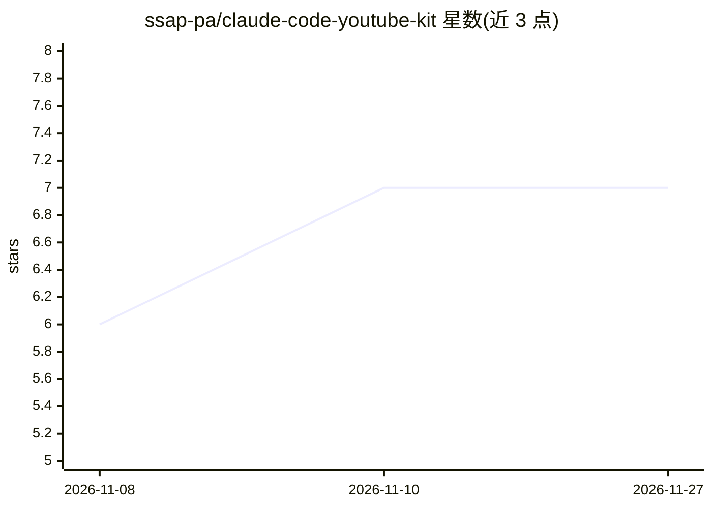

# ssap-pa/claude-code-youtube-kit

⭐ 7 · Python · NOASSERTION · 推送 2026-11-02 · [GitHub](https://github.com/ssap-pa/claude-code-youtube-kit) · [官网](https://ssapable.com) · 个人维护

**让 Claude Code 学习你的反馈来自动化制作 YouTube 视频的免费工具包**

面向用 Claude Code 制作 YouTube 视频的创作者。核心机制是反馈闭环：hooks 记录每次纠正，skill 将其存为规则文件（一规则一文件），下次会话优先加载规则，避免重复提同样要求。附带内容生产工具链：HTML 场景 30fps 渲染的实拍 UI 编辑（画面动作与词级时间戳对齐）、ElevenLabs 文本转语音、上传前逐毫秒音画同步/转录/BGM 重叠/响度质检，以及 9:16 竖版 3D 短视频模板。文档为韩文。

## 筛选速览

| 维度 | 判定 | 备注 |
|---|---|---|
| AI 角色 | `ai-native` | 本体是模型或模型工具 |
| 许可风险 | `none` | NOASSERTION |
| 部署形态 | `None` |  |
| 模型依赖 | locked-api |  |
| 硬件要求 | — | 无带数字的原话,不猜 |
| 安装摩擦 | `medium` | 含编译或系统依赖之一 |
| 成熟度 | — | 结构信号不足 |

## 能力要点

- hooks + 反馈规则文件的反馈闭环，新会话自动加载已学规则
- HTML 场景 30fps 渲染，画面运动按词级时间戳自动对齐
- 上传前 QA：ms 级音画同步、转录比对、BGM 重叠与响度检查
-  ElevenLabs 接入，含词级时间语音合成与缓存省额度

## 适用场景

- 不用每次重复纠正，让 Claude Code 按积累的规则写脚本、做视频
- 批量制作带配音与字幕的竖版解说短视频
- 上传前自动检查音画同步和此前修过的问题是否复发

## 场景标签

`语音合成` `视频生成` · 领域:内容生成

## 证据(README 行号)

> L5: > **English:** A free Claude Code kit for YouTube automation that learns from your feedback. Hooks record every corr
> L9: 이 키트는 내가 한 말을 규칙 파일로 쌓고, 다음 작업을 시작할 때 AI가 그 규칙부터 읽게 만드는 구조예요. 그 위에 영상을 실제로 만드는 **편집 도구·음성·음성↔화면 싱크 검수**까지 넣었어요. 첫 영상
> L17: |피드백 기록·세션 시작 훅|`hooks/`|내가 한 말을 원문 그대로 남기고, 새 세션·`/clear` 뒤마다 규칙 목록을 Claude에게 넣어요|

## 星数曲线

2026-11-08 6 → 2026-11-27 7（+1）

---
*卡片 v1 · prompt 1.4 · 生成 2026-11-20 · 置信度 high · 依据 README sha `c8dba7455a18` · [字段定义](../../DATASET.md)*
