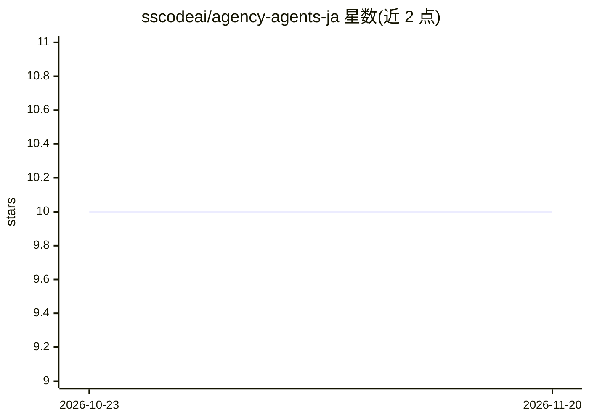

# sscodeai/agency-agents-ja

⭐ 10 · Shell · MIT · 推送 2026-11-19 · [GitHub](https://github.com/sscodeai/agency-agents-ja) · 个人维护 · 中文 README

**面向日本IT交付的413个AI专业角色提示词库**

msitarzewski/agency-agents 的日语社区版，收录 413 个 AI 专家角色（130 个日本市场原创、283 个上游改写适配），覆盖 SIer/受托开发、SaaS、制造 DX、公共部门等 22 类场景，另含 27 条多 agent 工作流。每个 agent 文件带有角色、确认要点、产出物等 frontmatter 与正文定义，供 Claude Code、Cursor 等编程工具加载。支持 19 种工具，多数需先经 convert.sh 生成集成文件。npm/npx 安装，MIT 许可。

## 筛选速览

| 维度 | 判定 | 备注 |
|---|---|---|
| AI 角色 | `ai-knowledge` | 知识聚合/清单类 |
| 许可风险 | `permissive` | MIT |
| 部署形态 | `library` | 以包/库形式分发 |
| 模型依赖 | — | README 未给出锁定关系 |
| 硬件要求 | — | 无带数字的原话,不猜 |
| 安装摩擦 | `low` | 无编译、无系统依赖或容器化 |
| 成熟度 | — | 结构信号不足 |

## 能力要点

- 413 个 agent 覆盖 22 类别，130 个为日本市场原创（SIer 检收、APPI 合规、kintone 等场景）
- 27 条端到端工作流将多个 agent 串联执行
- 适配 19 种 AI 编码工具，多数经 scripts/convert.sh 生成集成文件后安装
- frontmatter schema 与 validate.sh 强制校验 agent 文件结构

## 适用场景

- 在 Claude Code/Cursor 等工具中按角色加载 SIer 需求工程、检收审查 agent
- 为日本市场项目查找合规（个人情报保护法/发票制度）相关 AI 角色
- 用工作流串联多 agent 执行需求评审、数据迁移就绪检查等流程

## 场景标签

`提示工程` `网络安全` · 领域:Agent 开发

## 证据(README 行号)

> L31: > ** 413 ready-to-use AI specialist agents** for Japanese IT delivery — engineering, GIS, healthcare, design, marke
> L186: `agency-agents-ja` は、AI coding tool に読み込ませて使う**専門 role library** です。agent file には、identity、想定シーン、必ず確認すること、成果物、実務上の

## 星数曲线

2026-10-23 10 → 2026-11-20 10（+0）

---
*卡片 v1 · prompt 1.4 · 生成 2026-11-19 · 置信度 mid · 依据 README sha `02c28a2a7346` · [字段定义](../../DATASET.md)*
