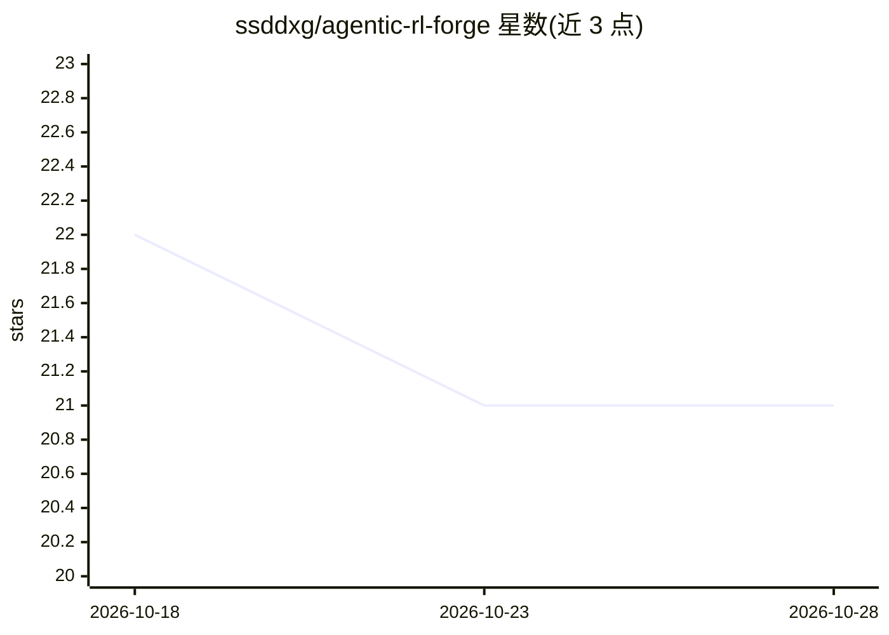

# ssddxg/agentic-rl-forge

⭐ 21 · Python · Apache-2.0 · 推送 2026-10-14 · [GitHub](https://github.com/ssddxg/agentic-rl-forge) · 个人维护 · 中文 README

**本地 Agent RL 工作台：Search-R1 轨迹采集与训练数据交付**

面向强化学习研究者的本地优先工作台：浏览器 Studio 中执行两步搜索 agent 轨迹、检查工具调用与奖励信号、上传自有 QA/检索 JSONL，在纯 CPU 上运行分组 rollout 离线管线，产出评估报告、可恢复分片与经校验的 verl 兼容训练批次；同时提供 Python 包与 arf CLI，覆盖 GRPO 工具、PRM 引导 MCTS、拒绝采样、Nash-MD 自博弈、事后重标注与可复现实验矩阵。GPU 权重训练仍需另行安装 PyTorch 与 verl，运行时检查会区分两者就绪状态。附带辅助性私有知识库（多语言 BM25 检索、可选 OpenAI 兼容问答）。无遥测，无需账号或 API key。

## 筛选速览

| 维度 | 判定 | 备注 |
|---|---|---|
| AI 角色 | `ai-ecosystem` | LLM/agent 周边工具 |
| 许可风险 | `permissive` | Apache-2.0 |
| 部署形态 | `self-host` | docker 或自建部署 |
| 模型依赖 | local-ok | 支持本地模型 |
| 硬件要求 | `cpu-ok` | |
| 安装摩擦 | `low` | 无编译、无系统依赖或容器化 |
| 成熟度 | — | 结构信号不足 |

## 能力要点

- 纯 CPU 分组 rollout 离线管线，产出可恢复分片与校验过的 trainer batch
- GRPO 工具、PRM/MCTS、拒绝采样、Nash-MD、事后重标注覆盖于 Python 包与 CLI
- verl 兼容任务/轨迹导出与 OpenAI 兼容 vLLM/SGLang 客户端
- 辅助本地知识库：PDF/DOCX/HTML 等摄取、多语言 BM25 检索

## 适用场景

- 为 GRPO/verl 训练准备经过校验的分组轨迹数据
- 在笔记本上离线验证 Search-R1 风格的 agent RL 数据链路
- 管理可复现的实验矩阵与检查点晋升证据

## 场景标签

`强化学习` `科研工具` · 领域:学习与行业

## 证据(README 行号)

> L18: AgenticRLForge Studio exposes the repository's real reinforcement-learning workflow in a local
> L20: your own QA and retrieval JSONL data, execute the CPU-only grouped-rollout pipeline, and review the
> L79: |RL|GRPO advantage utilities and verl-compatible task/trajectory export|

## 星数曲线

2026-10-18 22 → 2026-10-28 21（-1）

---
*卡片 v1 · prompt 1.4 · 生成 2026-10-28 · 置信度 high · 依据 README sha `3a902c2d105b` · [字段定义](../../DATASET.md)*
