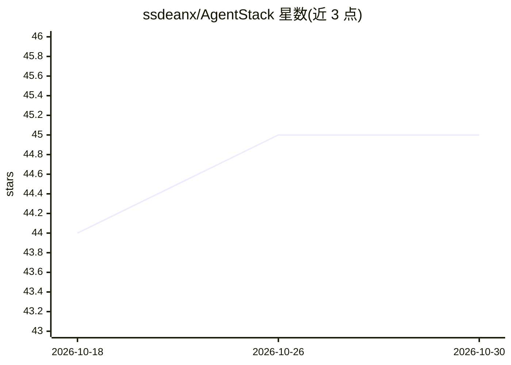

# ssdeanx/AgentStack

⭐ 45 · TypeScript · 推送 2026-04-21 · [GitHub](https://github.com/ssdeanx/AgentStack) · 个人维护

**基于 Mastra 的企业级多 Agent 框架：工具、Agent、工作流与编排**

构建于 Mastra 之上的 AI Agent 平台，TypeScript/Next.js 技术栈。提供 57 个企业工具、25+ 专门 Agent、10+ 工作流、12+ 监督者网络，支持 A2A/MCP 编排；覆盖金融数据接入（Polygon/Finnhub/AlphaVantage 30+ 端点）、LibSQL 向量检索的 RAG 流水线（3072D 嵌入 + BM25 重排 + 图遍历）、Langfuse 可观测性与 Better Auth/RBAC 安全治理，含 105 个 UI 组件与 1590+ 行 TanStack Query hooks。多模式编排 Harness 标注为 Alpha 状态。面向构建生产级多 Agent 系统的开发者。

## 筛选速览

| 维度 | 判定 | 备注 |
|---|---|---|
| AI 角色 | `ai-ecosystem` | LLM/agent 周边工具 |
| 许可风险 | `none` | — |
| 部署形态 | `desktop` | 安装包/桌面程序 |
| 模型依赖 | — | README 未给出锁定关系 |
| 硬件要求 | — | 无带数字的原话,不猜 |
| 安装摩擦 | `low` | 无编译、无系统依赖或容器化 |
| 成熟度 | `idea` | |

## 能力要点

- 57 个企业工具、25+ Agent、10+ 工作流、12+ 监督者网络与 A2A/MCP 编排
- LibSQL RAG 流水线：3072D 嵌入、BM25 重排、图遍历上下文扩展
- 金融数据接入：Polygon/Finnhub/AlphaVantage 共 30+ 端点
- 内置追踪观测、Langfuse 集成、Better Auth + RBAC 安全体系

## 适用场景

- 搭建带监督者网络的多 Agent 编排系统
- 构建企业级 RAG 问答与文档检索流水线
- 接入多源金融数据做股票与市场分析
- 为 Agent 系统接入观测、评测与权限治理

## 场景标签

`Agent 框架` `多智能体` `RAG` `金融量化` · 领域:Agent 开发

## 证据(README 行号)

> L29: **AgentStack** is a **production-grade AI agent platform** built on Mastra, delivering **57 enterprise tools**, **2
> L86: - **🔌 A2A/MCP**: MCP server coordinates parallel agents (research+stock→report), A2A coordinator for cross-agent co

## 星数曲线

2026-10-18 44 → 2026-10-30 45（+1）

---
*卡片 v1 · prompt 1.4 · 生成 2026-10-25 · 置信度 high · 依据 README sha `b2d477f5fdec` · [字段定义](../../DATASET.md)*
