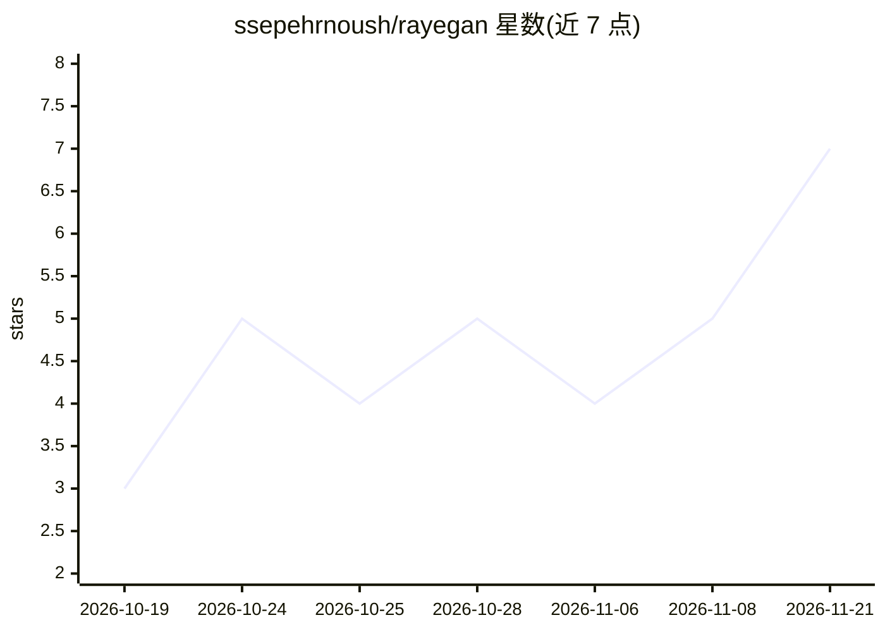

# ssepehrnoush/rayegan

⭐ 7 · JavaScript · MIT · 推送 2026-10-28 · [GitHub](https://github.com/ssepehrnoush/rayegan) · [官网](https://github.com/ssepehrnoush/rayegan#readme) · 个人维护

**为伊朗开发者聚合免费 LLM API 配额的本地 OpenAI 兼容网关**

本地运行的 LLM 网关，将 Groq、Gemini、OpenRouter 等免费额度和两个无密钥端点聚合为一个 OpenAI 兼容端点：按模型排行依次路由，配额用尽或出错时自动跳到下一模型，并提供用量计数、故障模型退避与波斯语仪表盘。针对伊朗网络环境支持 v2ray/Xray 代理检测与 403 自动走代理，附带 doctor 命令实测各服务可达性。通过 npx 一条命令启动，无中央服务器，默认仅监听 127.0.0.1。

## 筛选速览

| 维度 | 判定 | 备注 |
|---|---|---|
| AI 角色 | `ai-ecosystem` | LLM/agent 周边工具 |
| 许可风险 | `permissive` | MIT |
| 部署形态 | `library` | 以包/库形式分发 |
| 模型依赖 | — | README 未给出锁定关系 |
| 硬件要求 | — | 无带数字的原话,不猜 |
| 安装摩擦 | `low` | 无编译、无系统依赖或容器化 |
| 成熟度 | — | 结构信号不足 |

## 能力要点

- 无密钥即可用的两个端点（Kilo、OVHcloud）加可选免费 API key 聚合
- 按剩余配额依次路由：429/错误/空响应自动跳下一模型，含分错误类型的退避策略
- 代理感知：先直连探测，403 中途自动转 v2ray/Xray 代理，支持 --proxy 与 SOCKS5
- doctor 命令实测各服务在本网络的可达性，波斯语仪表盘与用量统计

## 适用场景

- 用 Cline/Aider/Continue 写代码时聚合多个免费 LLM 配额避免手动换 key
- 在伊朗网络环境下判断哪些 LLM 服务可用、是否需要代理
- 以统一 OpenAI 兼容端点接入本地或个人项目

## 场景标签

`模型网关` · 领域:Agent 开发

## 证据(README 行号)

> L15: هر کلید رایگانی هم که دارید (Groq، Gemini، OpenRouter و بقیه) پشت همان آدرس جمع می‌شود: باهوش‌ترین مدلی که هنوز سهم
> L19: برنامه‌نویس ایرانی برای OpenAI و Claude نمی‌تواند پول بدهد. سرویس‌های رایگان هم هستند، ولی هر کدام یک سقف کوچک دارن
> L107: ۱. **پیدا کردن مدل‌ها.** موقع شروع، و بعد هر ۶ ساعت، از هر سرویس فهرست مدل‌های فعلی‌اش را می‌گیرد. مدل‌های رایگان 

## 星数曲线

2026-10-19 3 → 2026-11-21 7（+4）

---
*卡片 v1 · prompt 1.4 · 生成 2026-11-21 · 置信度 high · 依据 README sha `8e0c3eae0350` · [字段定义](../../DATASET.md)*
