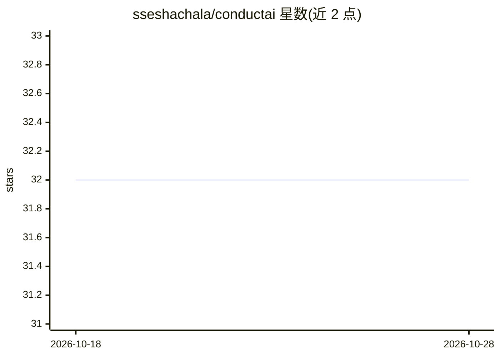

# sseshachala/conductai

⭐ 32 · Python · Apache-2.0 · 推送 2026-10-19 · [GitHub](https://github.com/sseshachala/conductai) · [官网](https://conductai.ai) · 组织维护

**AI agent 运行时治理平台：策略拦截每次模型/工具调用**

面向工程团队与合规角色的 AI agent 控制平面，由三部分组成：Guard 策略引擎（在动作执行前判定 block/warn/audit/inject，签名配置、SHA-256 哈希链审计、fail-closed）、Router LLM 代理（任意 Anthropic/OpenAI 等 SDK 指向它）、Lens 聊天界面。三个执行面为 CLI hook、MCP 层、Router。内置 15 个合规包（SOC 2、HIPAA、PCI DSS、EU AI Act 等）与 20 个 YAML playbook。支持 pip 安装 CLI、docker compose 自托管与托管服务（免费层为只读 Discovery，付费层解锁执行与 Router）。

## 筛选速览

| 维度 | 判定 | 备注 |
|---|---|---|
| AI 角色 | `ai-ecosystem` | LLM/agent 周边工具 |
| 许可风险 | `permissive` | Apache-2.0 |
| 部署形态 | `self-host` | docker 或自建部署 |
| 模型依赖 | — | README 未给出锁定关系 |
| 硬件要求 | — | 无带数字的原话,不猜 |
| 安装摩擦 | `low` | 无编译、无系统依赖或容器化 |
| 成熟度 | — | 结构信号不足 |

## 能力要点

- 动作执行前的策略判定（block/warn/audit/inject）
- SHA-256 哈希链审计与工作区签名配置、fail-closed 失败模式
- 15 个开箱合规包（OWASP/SOC 2/HIPAA/PCI DSS/EU AI Act 等）与 20 个 YAML playbook
- CLI hook、MCP 层、Router 三处统一策略执行

## 适用场景

- 企业对 Claude Code/Cursor 等 AI 编程会话做统一治理与审计
- 合规团队留存 SOC 2/HIPAA/PCI 等审计证据链
- 通过 LLM 代理端点对任意 SDK 调用做预算与策略控制

## 场景标签

 · 领域:LLM 基础设施/治理

## 证据(README 行号)

> L48: A control plane for AI agents. One policy decides `block / warn / audit / inject` for every LLM call, every shell t
> L66: Runtime firewalls like Straiker and Lakera tell you what an agent **did**. Conduct decides what it **can do**.
> L126: - **CLI hook** — every Claude Code / Cursor / Copilot / Codex tool call.

## 星数曲线

2026-10-18 32 → 2026-10-28 32（+0）

---
*卡片 v1 · prompt 1.4 · 生成 2026-10-25 · 置信度 high · 依据 README sha `cd1ceeb9d006` · [字段定义](../../DATASET.md)*
