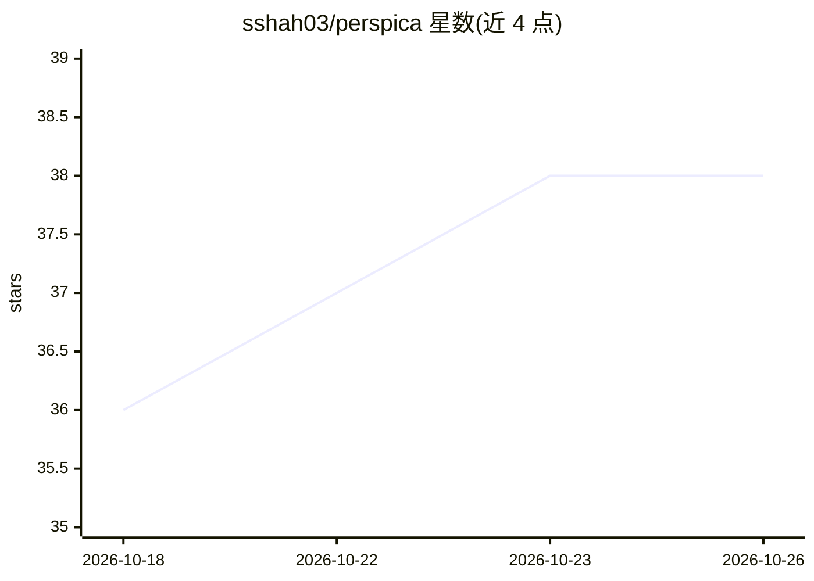

# sshah03/perspica

⭐ 38 · Rust · MIT · 推送 2026-10-22 · [GitHub](https://github.com/sshah03/perspica) · [官网](https://sshah03.github.io/perspica/) · 个人维护

**面向 AI 编码代理的代码变更审查工具，按意图解读 diff**

本地 Rust 二进制，用 tree-sitter 解析新旧两版代码并跟踪调用关系，对 diff 做语义分类：重命名、签名变更、函数移动、逻辑变更等，同时折叠格式化与注释等机械噪音，并指出普通 diff 隐藏的问题（引用已不存在的名称、未同步更新的调用、遗留未用代码），支持 12 种语言的语义分析。核心分析无需模型与 API key；可选接入 LLM 做按意图分组、风险评级与摘要。面向使用 Claude Code、Codex 等编码代理的开发者，可展示会话中的 prompt 并标记哪些改动是用户要求的。

## 筛选速览

| 维度 | 判定 | 备注 |
|---|---|---|
| AI 角色 | `ai-enhanced` | 去掉 AI 部分产品仍成立 |
| 许可风险 | `permissive` | MIT |
| 部署形态 | `library` | 以包/库形式分发 |
| 模型依赖 | local-ok | 支持本地模型 |
| 硬件要求 | — | 无带数字的原话,不猜 |
| 安装摩擦 | `medium` | 含编译或系统依赖之一 |
| 成熟度 | `idea` | |

## 能力要点

- tree-sitter 语义分析无需模型，本地毫秒级出结果
- 可选 LLM 分析：按意图分组、风险评级、摘要，支持 Claude Code/API key/Ollama 三种方式
- Learn 标签页讲解变更涉及的概念，附测验与图示
- 检测重命名残留引用、未更新调用与遗留未用代码

## 适用场景

- 审查 AI 编码代理产出的改动，区分我要求的与代理自行决定的
- 在合并前理解一个不熟悉的 PR 依赖的概念与架构
- 过滤格式化噪音，按阅读顺序走读变更代码

## 场景标签

`代码审查` · 领域:编码与开发

## 证据(README 行号)

> L16: None of that needs a model. perspica parses both versions with tree-sitter and follows the calls between them, so i
> L74: Everything above works on its own. The optional LLM analysis (`-s`, or **Analyze…** in the viewer) runs through Cla

## 星数曲线

2026-10-18 36 → 2026-10-26 38（+2）

---
*卡片 v1 · prompt 1.4 · 生成 2026-10-25 · 置信度 high · 依据 README sha `3e754ef92eaa` · [字段定义](../../DATASET.md)*
