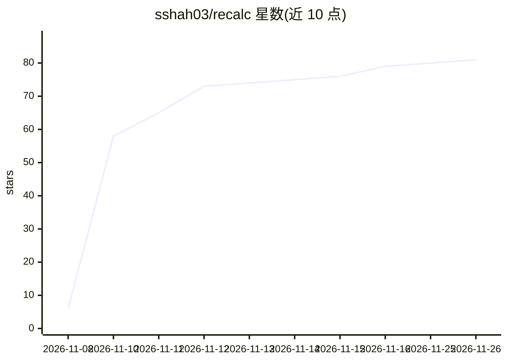

# sshah03/recalc

⭐ 81 · Rust · Apache-2.0 · 推送 2026-11-09 · [GitHub](https://github.com/sshah03/recalc) · 个人维护

**与 AI agent 共用的电子表格：单元格可放公式、命令或 Claude Code/Codex**

面向桌面用户的电子表格应用，每个单元格可以是数值、公式、终端命令、手动触发的 action 或 agent 单元格（@claude/@codex/@pi）。用户在网格中组织任务，agent 将计划与结果写入单元格，命令单元格可自动重跑以校验 agent 产出（如跑测试），并提供 MCP server 让外部 agent 操作看板、Driver agent 从 prompt 自动搭板。本机运行、无账号无服务端；agent 使用用户自己的 Claude/ChatGPT 订阅，本地模型可用于私密文档。macOS 为主，Linux 实验性，无 Windows。处于 early beta，未做 Apple 签名。

## 筛选速览

| 维度 | 判定 | 备注 |
|---|---|---|
| AI 角色 | `ai-ecosystem` | LLM/agent 周边工具 |
| 许可风险 | `permissive` | Apache-2.0 |
| 部署形态 | `desktop` | 安装包/桌面程序 |
| 模型依赖 | locked-api |  |
| 硬件要求 | — | 无带数字的原话,不猜 |
| 安装摩擦 | `medium` | 含编译或系统依赖之一 |
| 成熟度 | `idea` | |

## 能力要点

- 单元格可容纳公式、终端命令、action 与 agent（@claude/@codex/@pi）
- 命令单元格自动重跑校验 agent 产出，失败标红
- MCP server（recalc mcp）让外部 Claude Code 感知并操作看板
- 本机运行，无账号无追踪，看板即文件文件夹，可导出 Excel

## 适用场景

- 对成批文档按行列提出相同问题，agent 逐格作答并引用出处
- 并行运行多个 coding agent，用 Needs You 列表集中处理待办
- 在 agent 声称完成后用自动重跑的测试单元格核验其产出
- 财务/合规场景中用公式勾稽 agent 抽取的数字

## 场景标签

`多智能体` `编码 Agent` `文档问答` · 领域:Agent 开发

## 证据(README 行号)

> L25: In its current form, recalc gives you and your agents one shared grid. Every cell can hold a number, a formula, a t
> L95: claude mcp add recalc -- recalc mcp
> L110: |`@claude('summarize {A2}')`|an agent|Asks Claude (or `@codex`, `@pi`) and puts the answer in the cell. Only runs 

## 星数曲线

2026-11-08 6 → 2026-11-26 81（+75）

---
*卡片 v1 · prompt 1.4 · 生成 2026-11-18 · 置信度 mid · 依据 README sha `4f060861a848` · [字段定义](../../DATASET.md)*
