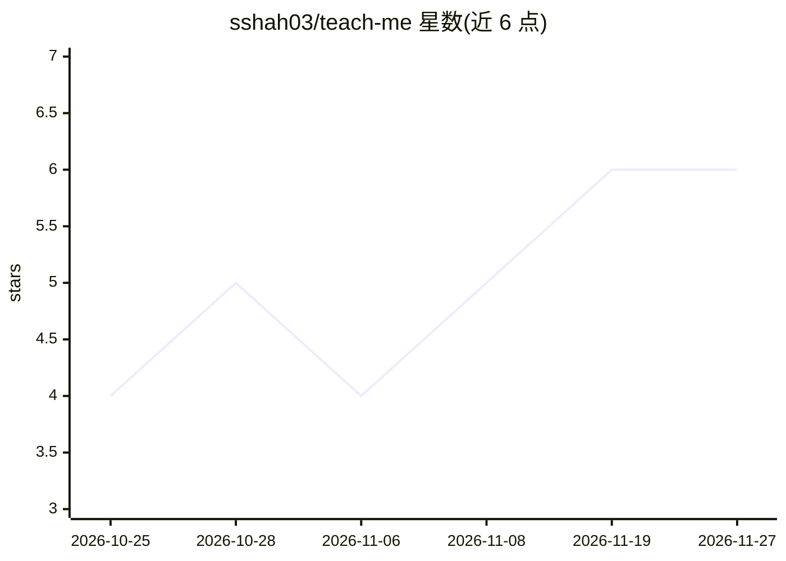

# sshah03/teach-me

⭐ 6 · Python · MIT · 推送 2026-10-19 · [GitHub](https://github.com/sshah03/teach-me) · 个人维护

**给开发者用 Claude Code 讲解 PR 背后思想的插件**

一个 Claude Code 插件：对 pull request、未提交改动或描述的想法，挑选 1-3 个评审者需要理解的概念，为每个概念生成短课、基于改动自身代码的可交互图示和测验题。写入前由第二个 agent 对照代码做对抗性校验并修正错误。生成的页面保存为 Claude 账户的 Artifact，或无 Artifact 工具时存为 HTML 文件。需 Claude Code、Python 3.9+ 与 GitHub CLI，仅通过 /teach-me 命令触发。

## 筛选速览

| 维度 | 判定 | 备注 |
|---|---|---|
| AI 角色 | `ai-native` | 本体是模型或模型工具 |
| 许可风险 | `permissive` | MIT |
| 部署形态 | `None` |  |
| 模型依赖 | — | README 未给出锁定关系 |
| 硬件要求 | — | 无带数字的原话,不猜 |
| 安装摩擦 | `low` | 无编译、无系统依赖或容器化 |
| 成熟度 | — | 结构信号不足 |

## 能力要点

- 从改动代码生成分步播放的可交互图示与动画
- 独立 agent 对照代码做对抗性事实校验
- 支持自己的 PR、任意公开 PR、未提交改动或口头描述的想法
- 通过 /plugin marketplace 安装与更新

## 适用场景

- 评审 PR 前补齐其中不熟悉的概念
- 学习他人公开仓库 pull request 里的设计思路
- 理解自己未提交改动所依赖的机制

## 场景标签

`教程课程` · 领域:学习与行业

## 证据(README 行号)

> L18: change. teach-me helps with that part. It picks the one to three ideas a reviewer needs, and explains
> L20: questions. Before you see anything, a separate agent checks every explanation against the code as
> L3: Ask Claude Code to explain the ideas behind a code change, and get a short lesson with a diagram

## 星数曲线

2026-10-25 4 → 2026-11-27 6（+2）

---
*卡片 v1 · prompt 1.4 · 生成 2026-11-20 · 置信度 high · 依据 README sha `882272eee1db` · [字段定义](../../DATASET.md)*
