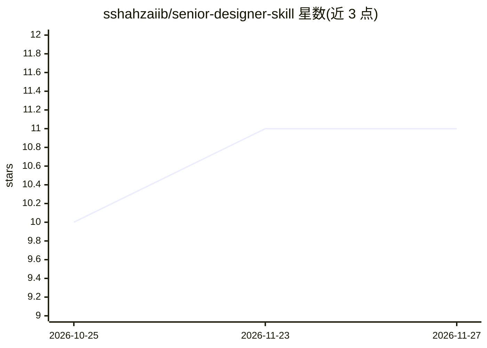

# sshahzaiib/senior-designer-skill

⭐ 11 · MIT · 推送 2026-06-17 · [GitHub](https://github.com/sshahzaiib/senior-designer-skill) · 个人维护

**面向 Claude Code 的循证高级产品设计师技能包**

一个安装在 Claude Code 技能目录中的 UI/UX 设计技能：将设计/构建任务拆为平台判定、竞品研究、设计简报、按 tokens 实现、清单评分验证五个阶段；规则取自 158 篇已审核设计出版物（Apple HIG、WCAG、NN/g、Refactoring UI 等），输出须通过 43 项（Web）/55 项（SwiftUI）评分清单。README 给出对一个 SwiftUI 应用的审计示例，并附 SKILL.md、评分清单与 evals 文件。安装方式为 git clone 到 ~/.claude/skills/ 目录。

## 筛选速览

| 维度 | 判定 | 备注 |
|---|---|---|
| AI 角色 | `ai-knowledge` | 知识聚合/清单类 |
| 许可风险 | `permissive` | MIT |
| 部署形态 | `None` |  |
| 模型依赖 | — | README 未给出锁定关系 |
| 硬件要求 | — | 无带数字的原话,不猜 |
| 安装摩擦 | `low` | 无编译、无系统依赖或容器化 |
| 成熟度 | — | 结构信号不足 |

## 能力要点

- 设计规则源自 158 篇已审核出版物并带引用与评分细则
- 五阶段工作流：研究→设计简报→实现→评分清单验证
- 43 项（Web）/55 项（SwiftUI）评分清单，满分才通过
- 内置对 AI 生成痕迹的硬性禁令清单与 evals 断言

## 适用场景

- 让 Claude Code 按研究驱动流程设计或构建 UI 页面
- 对已有 Web/SwiftUI 界面做可评分的无障碍与设计审计
- 生成设计 tokens 并约束实现遵循简报决策

## 场景标签

`提示工程` · 领域:Agent 开发

## 证据(README 行号)

> L1: # Senior Product Designer — a Claude Code skill for UI/UX design
> L5: Unconstrained LLMs emit the statistical median of their training data, and that median *is* the "AI slop" aesthetic:
> L25: ## Install the Senior Designer skill for Claude Code

## 星数曲线

2026-10-25 10 → 2026-11-27 11（+1）

---
*卡片 v1 · prompt 1.4 · 生成 2026-11-19 · 置信度 high · 依据 README sha `510f47c3dcdf` · [字段定义](../../DATASET.md)*
