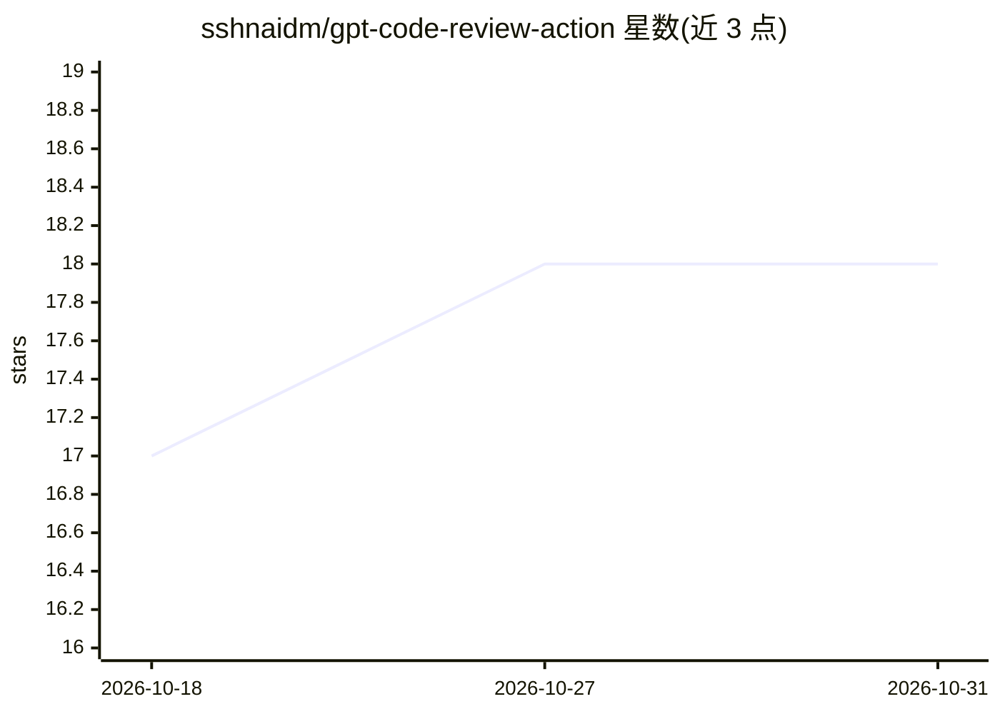

# sshnaidm/gpt-code-review-action

⭐ 18 · Python · Apache-2.0 · 推送 2026-04-18 · [GitHub](https://github.com/sshnaidm/gpt-code-review-action) · 个人维护

**调用 OpenAI 兼容服务对 PR 代码变更做 AI 审查的 GitHub Action**

GitHub Action 形式的代码审查工具：在 pull_request 工作流的 checkout 步骤之后调用，读取 PR 代码 diff，发送给 OpenAI GPT 模型（默认 gpt-4.1-mini，需提供 openai-key），将模型返回的审查结果以评论形式发回 PR。支持自定义 prompt、评论标题、diff 截断长度（默认 8000 字符）与出错时是否仍发评论。描述称兼容任何 OpenAI 兼容服务。以 Python 3.10 实现，Apache 2.0 许可。

## 筛选速览

| 维度 | 判定 | 备注 |
|---|---|---|
| AI 角色 | `ai-ecosystem` | LLM/agent 周边工具 |
| 许可风险 | `permissive` | Apache-2.0 |
| 部署形态 | `None` |  |
| 模型依赖 | — | README 未给出锁定关系 |
| 硬件要求 | — | 无带数字的原话,不猜 |
| 安装摩擦 | `low` | 无编译、无系统依赖或容器化 |
| 成熟度 | — | 结构信号不足 |

## 能力要点

- 在 PR 工作流中调用 OpenAI 模型审查代码 diff 并以评论回帖
- 默认模型 gpt-4.1-mini，描述称兼容任何 OpenAI 兼容服务
- 可配置 prompt、diff 截断长度（默认 8000 字符）、评论标题
- 需要 pull-requests: write 与 contents: read 权限

## 适用场景

- 在 PR 中自动获得 AI 生成的代码审查评论
- 用自定义 prompt 定制审查关注点

## 场景标签

`代码审查` · 领域:编码与开发

## 证据(README 行号)

> L3: This action uses the OpenAI GPT-4 language model to review code changes in a pull request.
> L16: The action will post the OpenAI review as a comment on the pull request.

## 星数曲线

2026-10-18 17 → 2026-10-31 18（+1）

---
*卡片 v1 · prompt 1.4 · 生成 2026-10-29 · 置信度 high · 依据 README sha `8380ad1811c1` · [字段定义](../../DATASET.md)*
