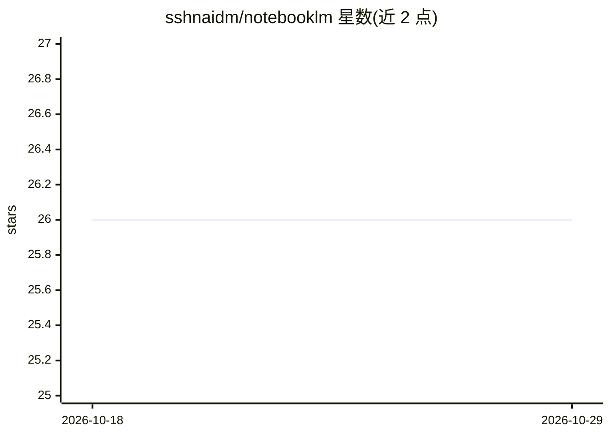

# sshnaidm/notebooklm

⭐ 26 · Shell · Apache-2.0 · 推送 2026-02-23 · [GitHub](https://github.com/sshnaidm/notebooklm) · 个人维护

**为 NotebookLM 准备文档的转换/OCR/分块脚本集**

一组 Shell 与 Python 脚本，处理 PDF、DJVU、EPUB、MOBI、DOCX 等多种格式，转换为文本或经 Tesseract OCR 后按字数上限（默认 40 万词）切分，生成适合上传 NotebookLM 的分块文件。主入口 prepare_all.sh 批量处理目录内文件，附 PDF/DJVU/文本工具子目录及基于 Playwright 的 NotebookLM 浏览器自动化脚本。需自行安装 poppler-utils、qpdf、ocrmypdf、Calibre、djvulibre、tesseract 等系统依赖方可运行。

## 筛选速览

| 维度 | 判定 | 备注 |
|---|---|---|
| AI 角色 | `ai-enhanced` | 去掉 AI 部分产品仍成立 |
| 许可风险 | `permissive` | Apache-2.0 |
| 部署形态 | `library` | 以包/库形式分发 |
| 模型依赖 | — | README 未给出锁定关系 |
| 硬件要求 | — | 无带数字的原话,不猜 |
| 安装摩擦 | `low` | 无编译、无系统依赖或容器化 |
| 成熟度 | — | 结构信号不足 |

## 能力要点

- 支持 PDF/DJVU/EPUB/MOBI/DOCX 等十余种格式的转换与分块
- 无文本层 PDF/DJVU 自动 OCR（Tesseract，可配多语言）
- 按字数上限切分输出，可用环境变量调参
- 含 Playwright 浏览器自动化，向 NotebookLM 添加来源链接

## 适用场景

- 把大量电子书/扫描文档切成可上传 NotebookLM 的分块
- 为无文本层的扫描 PDF 添加 OCR 后再切分
- 自动化向 NotebookLM 笔记本批量添加链接来源

## 场景标签

`OCR` `文档解析` `浏览器自动化` · 领域:效率与自动化

## 证据(README 行号)

> L3: Scripts and tools for preparing documents of various formats for NotebookLM. Handles PDF, DJVU, EPUB, FB2, MOBI, DOC
> L7: The main entry point. Converts and splits documents of various formats into word-count-limited chunks ready for Note

## 星数曲线

2026-10-18 26 → 2026-10-29 26（+0）

---
*卡片 v1 · prompt 1.4 · 生成 2026-10-26 · 置信度 mid · 依据 README sha `de383ffd3618` · [字段定义](../../DATASET.md)*
