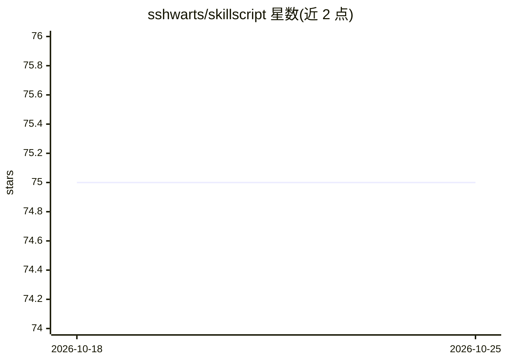

# sshwarts/skillscript

⭐ 75 · TypeScript · MIT · 推送 2026-10-12 · [GitHub](https://github.com/sshwarts/skillscript) · 个人维护

**供 agent 编写可审批自动化技能的声明式 DSL 与运行时**

受 Make 启发的小型声明式语言，含运行时、编译器与 CLI（skillfile）。流程：MCP 连接的 agent 编写 skill，人类在 dashboard/CLI 审查批准，运行时通过 connector、默认拒绝的 shell/文件系统 allowlist 与安全策略执行，凭据由运行时持有。技能可定时触发、调用 connector、组合复用，编排能力而非承载计算。面向不希望 agent 拥有 unrestricted shell 访问的团队，npm 全局安装即可用。项目处于 pre-1.0，核心语言与 connector 契约仍在稳定中。

## 筛选速览

| 维度 | 判定 | 备注 |
|---|---|---|
| AI 角色 | `ai-ecosystem` | LLM/agent 周边工具 |
| 许可风险 | `permissive` | MIT |
| 部署形态 | `library` | 以包/库形式分发 |
| 模型依赖 | — | README 未给出锁定关系 |
| 硬件要求 | — | 无带数字的原话,不猜 |
| 安装摩擦 | `low` | 无编译、无系统依赖或容器化 |
| 成熟度 | `idea` | |

## 能力要点

- agent 编写、人类审批、运行时按 allowlist 执行的技能生命周期
- 默认拒绝的 shell/文件系统 allowlist 与运行时托管凭据
- 通过 MCP 暴露工具，支持 cron、事件、CLI 等多种触发方式
- secured 模式下技能需操作员签名批准方可生效

## 适用场景

- 让 agent 将重复任务固化为可版本化、可审查的技能
- 在不开放完整 shell 权限的前提下让 agent 执行自动化流程
- 定时运行磁盘检查等运维型工作流

## 场景标签

`工作流自动化` `Agent 框架` · 领域:Agent 开发

## 证据(README 行号)

> L16: Skillscript came from asking: what would a Makefile look like if it built skills instead of binaries? The answer is
> L18: It is built for teams that want agents to create and run recurring workflows without giving them unrestricted shell

## 星数曲线

2026-10-18 75 → 2026-10-25 75（+0）

---
*卡片 v1 · prompt 1.4 · 生成 2026-10-24 · 置信度 high · 依据 README sha `88d68300d004` · [字段定义](../../DATASET.md)*
