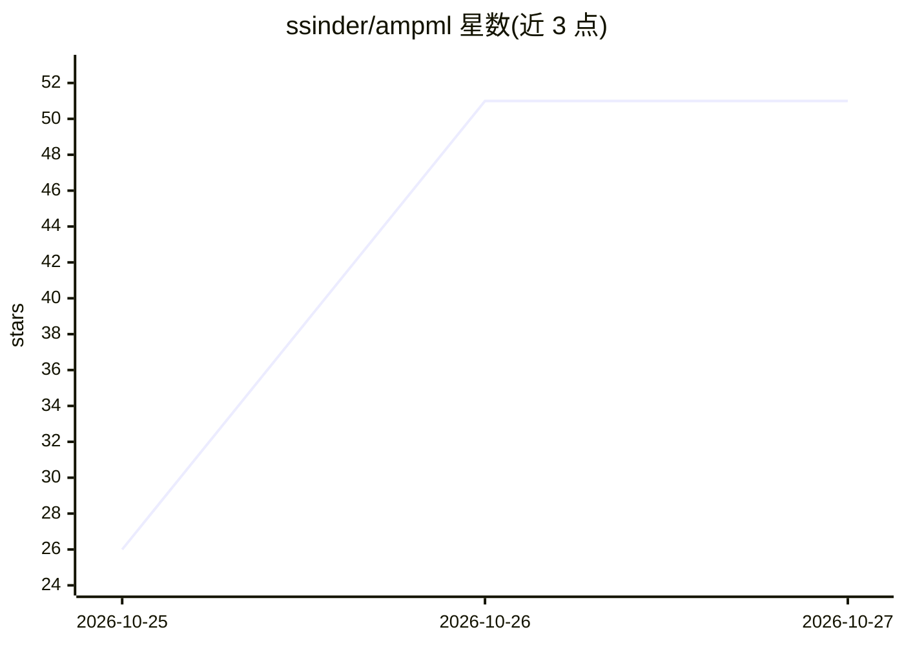

# ssinder/ampml

⭐ 51 · Python · MIT · 推送 2026-10-26 · [GitHub](https://github.com/ssinder/ampml) · 个人维护

**抗菌肽活性分类的可复现审计基准：6 模型+30 项核查**

面向抗菌肽（AMP）活性预测的机器学习基准项目：2557 样本、4921 维特征、6 个模型（推荐 Gradient Boosting，测试集准确率 0.8646），使用训练中从未参与选择的 n=384 留出测试集评估。核心机制是五层验证审计（30 项数值核查）、SHAP 归因，以及对负样本分布偏差的量化研究（长度匹配后准确率下降约 2.8 点）。限制：负样本来自 UniProt 片段、无外部独立验证集、上游 MMseqs2 聚类参数未记录。

## 筛选速览

| 维度 | 判定 | 备注 |
|---|---|---|
| AI 角色 | `ai-native` | 本体是模型或模型工具 |
| 许可风险 | `permissive` | MIT |
| 部署形态 | `library` | 以包/库形式分发 |
| 模型依赖 | — | README 未给出锁定关系 |
| 硬件要求 | — | 无带数字的原话,不猜 |
| 安装摩擦 | `low` | 无编译、无系统依赖或容器化 |
| 成熟度 | — | 结构信号不足 |

## 能力要点

- 五层独立验证审计覆盖 30 项数值核查（ampml verify）
- 留出测试集（n=384）不参与特征与模型选择
- 负样本偏差量化：长度匹配损失约 2.8 准确率点
- 4921 维特征维度核算零差异（iFeature/PseKRAAC/modlamp）

## 适用场景

- 运行抗菌肽活性预测并对特征表打分
- 复现或审计一个带完整核查链的 ML 分类基准
- 研究 AMP 分类任务中负样本构造对指标的影响

## 场景标签

 · 领域:计算生物学/生物信息学

## 证据(README 行号)

> L12: Antimicrobial peptide (AMP) activity prediction is a small-n, high-dimensional
> L20: contribution**. It ships a complete, one-command reproduction pipeline, a
> L60: |**Gradient Boosting** (recommended)|**0.8646**|0.8706|**0.9432**|12.06%|

## 星数曲线

2026-10-25 26 → 2026-10-27 51（+25）

---
*卡片 v1 · prompt 1.4 · 生成 2026-10-25 · 置信度 high · 依据 README sha `d0c66eb4f6a4` · [字段定义](../../DATASET.md)*
