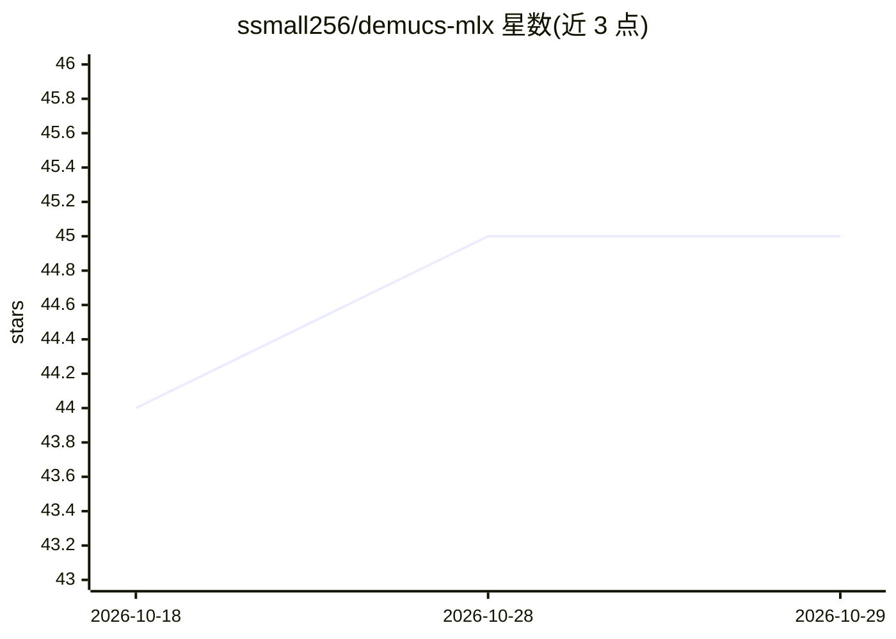

# ssmall256/demucs-mlx

⭐ 45 · Python · MIT · 推送 2026-10-05 · [GitHub](https://github.com/ssmall256/demucs-mlx) · 个人维护

**在 Apple Silicon 上分离歌曲人声/鼓/贝斯等分轨的 MLX 移植**

将 Meta Demucs 音乐源分离模型移植到 MLX，在 Mac 上把歌曲拆分为人声、鼓、贝斯等分轨，推理无需 PyTorch。提供 CLI 与 Python Separator API，支持全部注册模型（htdemucs 系列、mdx 系列等），权重从 Hugging Face 下载并经 SHA-256 校验，也可离线预取或从官方 checkpoint 转换。含自动硬件拓扑调批、自定义 Metal 融合内核与模型缓存信任边界机制。要求 macOS Apple Silicon 与 Python 3.10+。

## 筛选速览

| 维度 | 判定 | 备注 |
|---|---|---|
| AI 角色 | `ai-native` | 本体是模型或模型工具 |
| 许可风险 | `permissive` | MIT |
| 部署形态 | `library` | 以包/库形式分发 |
| 模型依赖 | — | README 未给出锁定关系 |
| 硬件要求 | — | 无带数字的原话,不猜 |
| 安装摩擦 | `low` | 无编译、无系统依赖或容器化 |
| 成熟度 | — | 结构信号不足 |

## 能力要点

- CLI 与 Python API 两种使用方式，分离为人声/鼓/贝斯等分轨
- 推理无需 PyTorch，权重下载经 SHA-256 校验，可离线预取或本地转换
- 支持 htdemucs/htdemucs_ft/htdemucs_6s/mdx 等全部注册模型
- 按 Apple Silicon 显存带宽/GPU 核数自动配置 batch size

## 适用场景

- 在 Mac 上把歌曲拆成人声和伴奏做卡拉OK或混音
- 用 Python API 在音频处理管线中批量生成分轨
- 无网络环境下离线下载权重后运行分离

## 场景标签

 · 领域:音频/音乐源分离

## 证据(README 行号)

> L3: Split any song into its individual stems — vocals, drums, bass, and other instruments — directly on your Mac.
> L5: demucs-mlx is a fast, native Apple Silicon port of Meta's Demucs music source separation model, built on MLX. No PyT

## 星数曲线

2026-10-18 44 → 2026-10-29 45（+1）

---
*卡片 v1 · prompt 1.4 · 生成 2026-10-25 · 置信度 high · 依据 README sha `2ce0afe7db31` · [字段定义](../../DATASET.md)*
