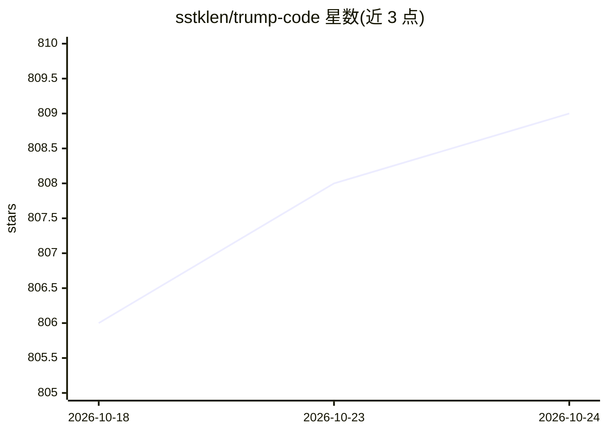

# sstklen/trump-code

⭐ 809 · Python · MIT · 推送 2026-10-23 · [GitHub](https://github.com/sstklen/trump-code) · 个人维护 · 中文 README

**用 AI 暴力搜索解码川普发帖与美股走势关系的预测系统**

对 7,400+ 条 Truth Social 帖子（三源交叉验证）做信号分析，暴力搜索 3,150 万个模型组合，产出 551 条通过训练/测试验证的规则与 11 个具名策略模型，对 566 条已验证预测给出 61.3% 命中率。闭环流程为预测→验证→学习→进化，每日运行。同时集成 Polymarket 预测市场追踪、实时仪表盘、公开 API、MCP Server（供 Claude Code/Cursor 调用 9 个工具）与开源数据集下载。README 声明仅供研究教育用途、非投资建议，并自述统计局限（多重比较偏差）。

## 筛选速览

| 维度 | 判定 | 备注 |
|---|---|---|
| AI 角色 | `ai-native` | 本体是模型或模型工具 |
| 许可风险 | `permissive` | MIT |
| 部署形态 | `None` |  |
| 模型依赖 | — | README 未给出锁定关系 |
| 硬件要求 | — | 无带数字的原话,不猜 |
| 安装摩擦 | `low` | 无编译、无系统依赖或容器化 |
| 成熟度 | — | 结构信号不足 |

## 能力要点

- 31.5 百万模型组合暴力搜索，551 条存活规则
- 11 个具名策略模型排行榜（命中率 37.5%–72.7%）
- Truth Social vs X 双平台对比（TS 领先 6.2 小时发布）
- MCP Server 提供 9 个工具供 Claude Code/Cursor 调用

## 适用场景

- 跟踪川普发帖信号与美股走势的统计关系
- 下载公开数据集（4.4 万条帖子、566 条预测日志）自行分析
- 通过 MCP/CLI/API 获取每日信号与多空共识

## 场景标签

`金融量化` · 领域:学习与行业

## 证据(README 行号)

> L6: **AI-powered cryptanalysis of presidential communications × stock market impact.**
> L31: Trump is the only person on Earth who can move global markets with a single social media post. This project applies
> L38: - **61.3% hit rate** across 566 verified predictions (z=5.39, p<0.05)

## 星数曲线

2026-10-18 806 → 2026-10-24 809（+3）

---
*卡片 v1 · prompt 1.4 · 生成 2026-10-21 · 置信度 high · 依据 README sha `0b0fbcc55a52` · [字段定义](../../DATASET.md)*
