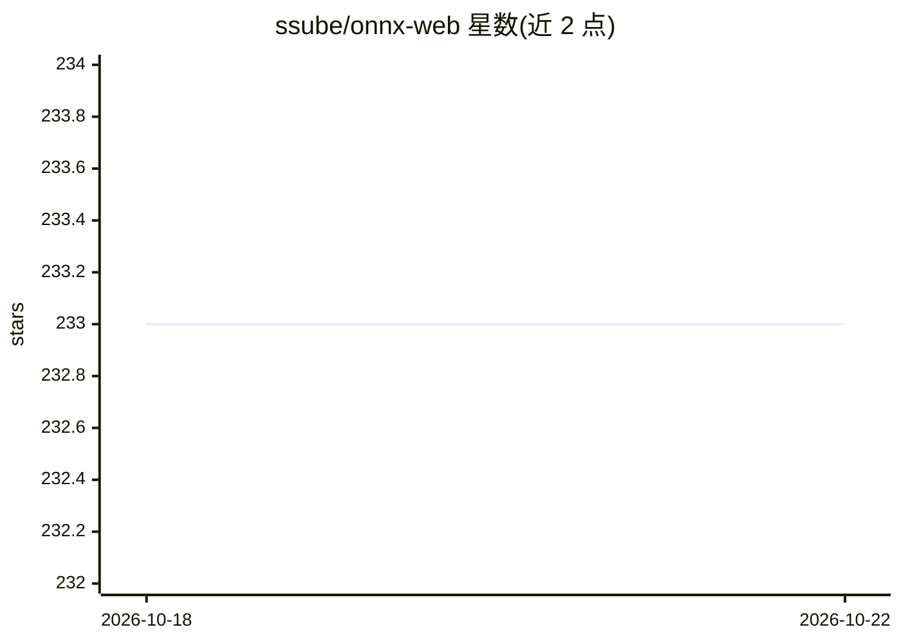

# ssube/onnx-web

⭐ 233 · Python · MIT · 推送 2025-12-02 · [GitHub](https://github.com/ssube/onnx-web) · [官网](https://discord.gg/7CdQmutGuw) · 个人维护

**网页运行 Stable Diffusion 等 ONNX 模型的图像生成服务**

基于 ONNX 管线运行 Stable Diffusion、上采样、人像修复等模型的 Web 应用与 REST API，支持 AMD/Nvidia GPU 加速（CUDA、DirectML、ROCm，含半精度）并提供纯 CPU 软件回退。提供 txt2img、img2img、inpainting、panorama、ControlNet、LoRA/LyCORIS/Textual Inversion、多阶段与区域提示词、高清多轮迭代等功能，可从 HuggingFace、Civitai 下载模型。以 pip 安装或 OCI 容器方式运行，面向在桌面、笔记本与多 GPU 服务器上做生成图像的用户；部分派生代码带额外许可限制。

## 筛选速览

| 维度 | 判定 | 备注 |
|---|---|---|
| AI 角色 | `ai-native` | 本体是模型或模型工具 |
| 许可风险 | `permissive` | MIT |
| 部署形态 | `library` | 以包/库形式分发 |
| 模型依赖 | — | README 未给出锁定关系 |
| 硬件要求 | `cpu-ok` | |
| 安装摩擦 | `medium` | 含编译或系统依赖之一 |
| 成熟度 | — | 结构信号不足 |

## 能力要点

- 支持 SDXL 与 SDXL Turbo，多种调度器
- AMD/Nvidia 硬件加速（CUDA/DirectML/ROCm）与 CPU 软件回退
- txt2img/img2img/inpainting/panorama/上采样/ControlNet 等多种管线
- 提供 OCI 容器，含 API 与 GUI，可跑在 RunPod、Vast.ai

## 适用场景

- 在 Windows 或 AMD 显卡上本地运行 Stable Diffusion 生成图像
- 通过网页 UI 做 inpainting、outpainting 与上采样、人像修复
- 用 REST API 在远程服务器或多 GPU 环境批量生成图像

## 场景标签

 · 领域:图像生成/AI 艺术

## 证据(README 行号)

> L3: onnx-web is designed to simplify the process of running Stable Diffusion and other ONNX models so you
> L4: can focus on making high quality, high resolution art. With the efficiency of hardware acceleration on both AMD and
> L15: Dive deeper into the onnx-web experience with its API, compatible with both Linux and Windows. This RESTful interfa

## 星数曲线

2026-10-18 233 → 2026-10-22 233（+0）

---
*卡片 v1 · prompt 1.4 · 生成 2026-10-22 · 置信度 high · 依据 README sha `cdb551e1ace5` · [字段定义](../../DATASET.md)*
