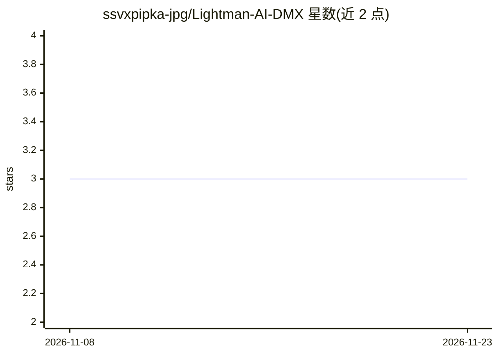

# ssvxpipka-jpg/Lightman-AI-DMX

⭐ 3 · Python · NOASSERTION · 推送 2026-11-15 · [GitHub](https://github.com/ssvxpipka-jpg/Lightman-AI-DMX) · 个人维护 · 中文 README

**剧场灯光 AI 助手：本地运行、控制专业灯光控制台**

运行在灯光控制台之上的辅助层，非替代控制台：内置 BlenderDMX 查看 3D 场景，理解 Art-Net/sACN/OSC 等 DMX 协议，通过 EpocCam 摄像头做演员追踪、光束分析与烟雾密度估计，本地 ChromDB 知识库覆盖 300+ 灯具。AI Director 采用 BYOK 方式接入 Groq、OpenRouter、Gemini、Mistral；含 Absolute Blackout 硬锁定（AI 无法解除）。通过 GitHub Releases 提供安装包，支持 Windows/macOS，面向学校剧场与小型工作室。

## 筛选速览

| 维度 | 判定 | 备注 |
|---|---|---|
| AI 角色 | `ai-enhanced` | 去掉 AI 部分产品仍成立 |
| 许可风险 | `none` | NOASSERTION |
| 部署形态 | `desktop` | 安装包/桌面程序 |
| 模型依赖 | locked-api |  |
| 硬件要求 | — | 无带数字的原话,不猜 |
| 安装摩擦 | `low` | 无编译、无系统依赖或容器化 |
| 成熟度 | — | 结构信号不足 |

## 能力要点

- AI Director 采用 BYOK 接入 Groq/OpenRouter/Gemini/Mistral
- 本地 RAG 知识库覆盖 300+ 灯具与 DMX 协议（ChromaDB）
- EpocCam 摄像头视觉：演员追踪、烟雾密度估计
- Absolute Blackout 硬锁定机制，AI 无法解除

## 适用场景

- 学校剧场用本地 AI 辅助编排舞台灯光
- 小型工作室通过 Art-Net/OSC 对接专业控制台
- 用摄像头追踪演员位置自动调整灯具

## 场景标签

`RAG` · 领域:知识与检索

## 证据(README 行号)

> L11: Lightman — это не замена консоли, а интеллектуальный слой поверх неё. Он видит 3D-сцену через встроенный BlenderDMX
> L15: - **AI Director (BYOK)**: Подключение Groq, OpenRouter, Gemini, Mistral, - **AI Director (BYOK)**: Подключение Groн

## 星数曲线

2026-11-08 3 → 2026-11-23 3（+0）

---
*卡片 v1 · prompt 1.4 · 生成 2026-11-21 · 置信度 mid · 依据 README sha `4f206ec19a22` · [字段定义](../../DATASET.md)*
