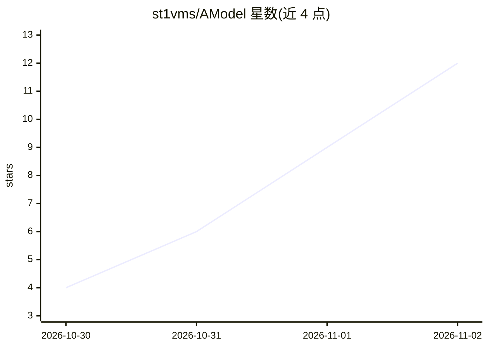

# st1vms/AModel

⭐ 12 · Python · 推送 2026-10-31 · [GitHub](https://github.com/st1vms/AModel) · 个人维护

**足球比赛结果预测引擎：数据管线+ML模型+回测**

面向足球数据分析的机器学习预测引擎：自动从 Football-Data.org、API-Football、Understat、FBref 及赔率 API 采集数据，经特征工程（滚动平均、Elo、xG、交锋史等）后用梯度提升/随机森林等分类器训练，输出胜平负及大小球市场的概率分布，并通过 Streamlit UI 交互运行。提供对 Bet365 收盘赔率的 walk-forward 回测与 CLV 评估 CLI。需 Python 3.9+，通过 setup.sh 或 venv+pip 手动安装，数据获取依赖外部 API 凭证与网络。

## 筛选速览

| 维度 | 判定 | 备注 |
|---|---|---|
| AI 角色 | `ai-native` | 本体是模型或模型工具 |
| 许可风险 | `none` | — |
| 部署形态 | `library` | 以包/库形式分发 |
| 模型依赖 | — | README 未给出锁定关系 |
| 硬件要求 | — | 无带数字的原话,不猜 |
| 安装摩擦 | `low` | 无编译、无系统依赖或容器化 |
| 成熟度 | — | 结构信号不足 |

## 能力要点

- 端到端自动化管线：数据采集→特征工程→训练→预测
- 特征含滚动平均、Elo 评分、xG/xA、交锋史与休整天数等
- 针对收盘赔率的 walk-forward 回测与 CLV 评估 CLI
- Streamlit 交互式 UI 运行

## 适用场景

- 预测欧洲五大联赛及欧战的比赛结果概率
- 对历史赛季做回测并复现分层收益报告
- 分析球队表现与市场赔率之间的价值区间

## 场景标签

 · 领域:体育数据分析/机器学习

## 证据(README 行号)

> L3: AModel is an advanced machine learning and data-driven football (soccer) prediction engine designed to forecast matc
> L13: 3. **Model Training:** Utilizes machine learning classifiers (such as Gradient Boosting / Random Forests) trained o
> L14: 4. **Inference & Prediction:** Evaluates upcoming fixtures using the trained models to output probability distribut

## 星数曲线

2026-10-30 4 → 2026-11-02 12（+8）

---
*卡片 v1 · prompt 1.4 · 生成 2026-11-02 · 置信度 mid · 依据 README sha `06694d61e34a` · [字段定义](../../DATASET.md)*
