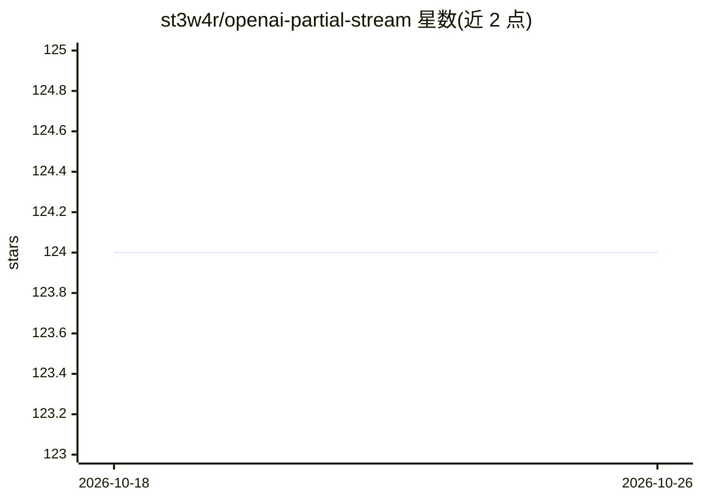

# st3w4r/openai-partial-stream

⭐ 124 · HTML · MIT · 推送 2026-08-23 · [GitHub](https://github.com/st3w4r/openai-partial-stream) · [官网](https://partial.stream/) · 个人维护

**将 LLM 令牌流边收边解析为可用 JSON 对象的库**

面向 LLM 应用开发者的 npm 库：在流式响应尚未结束时，把令牌流逐步解析为可处理的 JSON 对象，并借助 OpenAI Function Calling 实现早期流处理。支持按 zod schema 校验并按实体（entity）切分输出，多条目场景逐条交付。提供四种流模式（NoStream/StreamObject/StreamObjectKeyValue/StreamObjectKeyValueTokens），在 UI 更新粒度与网络流量之间做取舍。通过 npm 安装，提供 OpenAiHandler 接入 OpenAI SDK。

## 筛选速览

| 维度 | 判定 | 备注 |
|---|---|---|
| AI 角色 | `ai-ecosystem` | LLM/agent 周边工具 |
| 许可风险 | `permissive` | MIT |
| 部署形态 | `library` | 以包/库形式分发 |
| 模型依赖 | — | README 未给出锁定关系 |
| 硬件要求 | — | 无带数字的原话,不猜 |
| 安装摩擦 | `low` | 无编译、无系统依赖或容器化 |
| 成熟度 | — | 结构信号不足 |

## 能力要点

- 令牌流未结束时即解析为可用的 JSON 对象
- 支持 zod schema 校验与按实体切分输出
- 四种流模式在更新粒度与网络流量间取舍
- 配合 OpenAI Function Calling 做早期流处理

## 适用场景

- LLM 应用中实现流式渐进渲染的 UI
- 结构化输出流式到达时逐实体展示（如逐条列表）
- 按 schema 校验流式 JSON 片段再交付前端

## 场景标签

 · 领域:LLM 应用开发/流式处理

## 证据(README 行号)

> L3: - Convert a **stream of token** into a **parsable JSON** object before the stream ends.
> L31: import { OpenAiHandler, StreamMode } from "openai-partial-stream";

## 星数曲线

2026-10-18 124 → 2026-10-26 124（+0）

---
*卡片 v1 · prompt 1.4 · 生成 2026-10-23 · 置信度 high · 依据 README sha `772582d151d2` · [字段定义](../../DATASET.md)*
