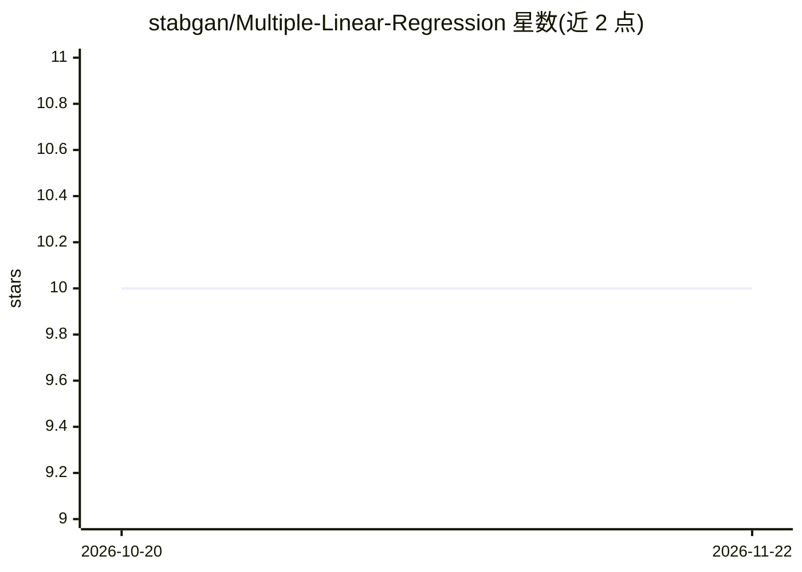

# stabgan/Multiple-Linear-Regression

⭐ 10 · Python · MIT · 推送 2026-03-14 · [GitHub](https://github.com/stabgan/Multiple-Linear-Regression) · 个人维护

**Python 与 R 双实现的多元线性回归教学示例项目**

基于 50 Startups 数据集的教学演示项目：读取研发投入、管理成本、营销支出与州别四列特征，经独热编码与 80/20 划分后拟合多元线性回归并输出 R²/RMSE，另用 statsmodels OLS 做向后消除以筛选最优预测变量子集。以两个脚本形式提供（Python 与 R 各一），依赖 numpy/pandas/scikit-learn/statsmodels 与 R 的 caTools。README 声明未做交叉验证与超参数调优，属简单演示性质。

## 筛选速览

| 维度 | 判定 | 备注 |
|---|---|---|
| AI 角色 | `ai-native` | 本体是模型或模型工具 |
| 许可风险 | `permissive` | MIT |
| 部署形态 | `library` | 以包/库形式分发 |
| 模型依赖 | — | README 未给出锁定关系 |
| 硬件要求 | — | 无带数字的原话,不猜 |
| 安装摩擦 | `low` | 无编译、无系统依赖或容器化 |
| 成熟度 | — | 结构信号不足 |

## 能力要点

- Python 与 R 两种语言的平行实现
- statsmodels OLS 向后消除筛选最优预测变量子集
- 内置 50_Startups.csv 数据集（50 条记录）

## 适用场景

- 学习多元线性回归的完整建模流程
- 对比 Python 与 R 的回归实现方式
- 演示向后消除特征选择方法

## 场景标签

`教程课程` · 领域:学习与行业

## 证据(README 行号)

> L3: Predict startup profitability using Multiple Linear Regression with Backward Elimination — implemented in both Pytho
> L11: 3. Fits a Multiple Linear Regression model and reports R² / RMSE
> L12: 4. Performs **Backward Elimination** (statsmodels OLS) to find the optimal predictor subset

## 星数曲线

2026-10-20 10 → 2026-11-22 10（+0）

---
*卡片 v1 · prompt 1.4 · 生成 2026-11-19 · 置信度 high · 依据 README sha `5523fa9432cc` · [字段定义](../../DATASET.md)*
