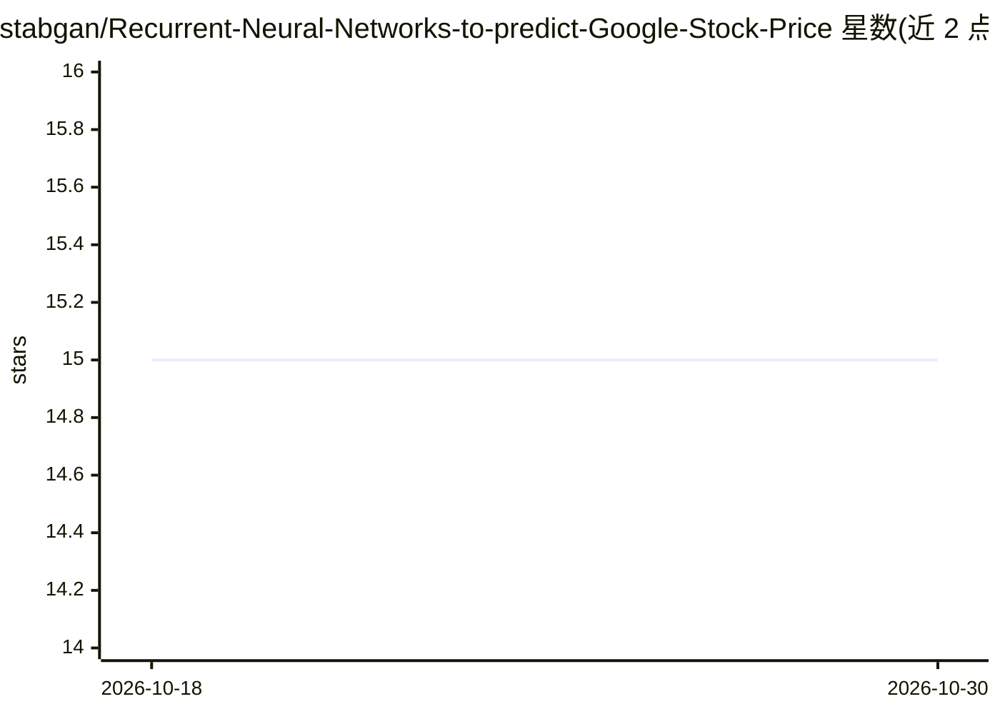

# stabgan/Recurrent-Neural-Networks-to-predict-Google-Stock-Price

⭐ 15 · Python · MIT · 推送 2026-03-14 · [GitHub](https://github.com/stabgan/Recurrent-Neural-Networks-to-predict-Google-Stock-Price) · 个人维护

**用 LSTM 预测 Google 股价的 PyTorch/TensorFlow 学习项目**

基于 LSTM 循环神经网络的股价预测实验项目：读取 Yahoo Finance 的 Google 开盘价历史数据（2012.1–2016.12 训练，2017.1 测试共 20 个交易日），经 MinMaxScaler 归一化后构造滑动窗口序列训练 LSTM，反归一化输出预测价格并绘图对比。项目比较不同时间步窗口（20/60）与网络深度（1/4 层）的配置效果。主要模型为 4 层 LSTM、每层 50 单元、20% dropout，训练 100 epochs。README 声明仅使用开盘价单一特征、无训练/验证划分。面向机器学习学习者，依赖 TensorFlow/Keras、NumPy、Pandas、Matplotlib、scikit-learn。

## 筛选速览

| 维度 | 判定 | 备注 |
|---|---|---|
| AI 角色 | `ai-native` | 本体是模型或模型工具 |
| 许可风险 | `permissive` | MIT |
| 部署形态 | `library` | 以包/库形式分发 |
| 模型依赖 | — | README 未给出锁定关系 |
| 硬件要求 | — | 无带数字的原话,不猜 |
| 安装摩擦 | `low` | 无编译、无系统依赖或容器化 |
| 成熟度 | `idea` | |

## 能力要点

- LSTM 序列建模：MinMaxScaler 归一化 + 滑动窗口（20/60 时间步）+ 反归一化预测
- 主模型 4 层 LSTM、每层 50 单元、20% dropout，Adam 优化器训练 100 epochs
- 对比 4 种配置（时间步窗口 × 网络深度）的预测结果
- README 列出已知限制：仅开盘价特征、无验证集与早停

## 适用场景

- 学习 LSTM 时间序列建模的完整流程
- 了解时间步窗口与网络深度对预测的影响
- 作为 RNN 股价预测的教学示例复现

## 场景标签

`教程课程` · 领域:学习与行业

## 证据(README 行号)

> L3: Predicting Google stock prices using Long Short-Term Memory (LSTM) recurrent neural networks.
> L7: Trains on historical Google opening stock prices (Jan 2012 – Dec 2016) and predicts January 2017 prices. The project

## 星数曲线

2026-10-18 15 → 2026-10-30 15（+0）

---
*卡片 v1 · prompt 1.4 · 生成 2026-10-30 · 置信度 mid · 依据 README sha `3fc9c940e70c` · [字段定义](../../DATASET.md)*
