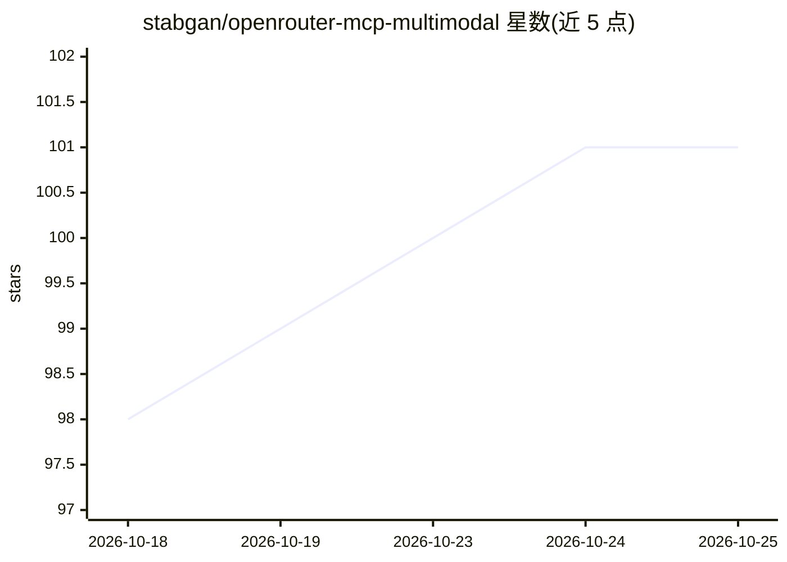

# stabgan/openrouter-mcp-multimodal

⭐ 101 · TypeScript · Apache-2.0 · 推送 2026-10-25 · [GitHub](https://github.com/stabgan/openrouter-mcp-multimodal) · [官网](https://www.npmjs.com/package/@stabgan/openrouter-mcp-multimodal) · 个人维护

**接入 OpenRouter 多模态 LLM API 的 MCP 服务器，21 个工具**

Node.js/TypeScript 实现的 Model Context Protocol 服务器，通过 stdio 将 AI 编码代理（Cursor、Claude Desktop、VS Code、Windsurf、Cline、Kiro 等）接入 OpenRouter 统一 LLM API。提供 21 个 MCP 工具，覆盖 300+ 模型的文本聊天、图像分析/生成、音频转录/TTS/STT、视频分析与生成（Veo 3.1、Sora、Seedance 等）、37+ 嵌入模型、重排序与结构化决策。含路径沙箱、SSRF 防护与 3929 个自动化测试。运行需 Node.js 22+ 与 OpenRouter API key，视频/音频生成通常需付费积分。

## 筛选速览

| 维度 | 判定 | 备注 |
|---|---|---|
| AI 角色 | `ai-ecosystem` | LLM/agent 周边工具 |
| 许可风险 | `permissive` | Apache-2.0 |
| 部署形态 | `self-host` | docker 或自建部署 |
| 模型依赖 | locked-api |  |
| 硬件要求 | — | 无带数字的原话,不猜 |
| 安装摩擦 | `low` | 无编译、无系统依赖或容器化 |
| 成熟度 | — | 结构信号不足 |

## 能力要点

- 21 个 MCP 工具覆盖文本/视觉/音频/视频的分析与生成
- 接入 OpenRouter 300+ 模型，支持 :nitro/:free 等路由后缀
- 专用 TTS（Deepgram/ElevenLabs/OpenAI）与 STT（Whisper/Voxtral 等）通道
- 路径沙箱、SSRF 防护、13 类结构化错误码

## 适用场景

- 在 Cursor/Claude Desktop 等 MCP 客户端中直接调用 OpenRouter 的多模态模型
- 代理内完成图像/音频/视频的分析与生成任务
- RAG 场景中使用嵌入与文档重排序工具

## 场景标签

`图像生成` `语音合成` `视频生成` `语音识别` · 领域:内容生成

## 证据(README 行号)

> L32: **OpenRouter MCP Multimodal** is a production-grade Model Context Protocol (MCP) server — listed on the official MC
> L74: MCP servers are distributed through several packaging models. **This server is implemented in Node.js/TypeScript**;

## 星数曲线

2026-10-18 98 → 2026-10-25 101（+3）

---
*卡片 v1 · prompt 1.4 · 生成 2026-10-23 · 置信度 high · 依据 README sha `608c844282cc` · [字段定义](../../DATASET.md)*
