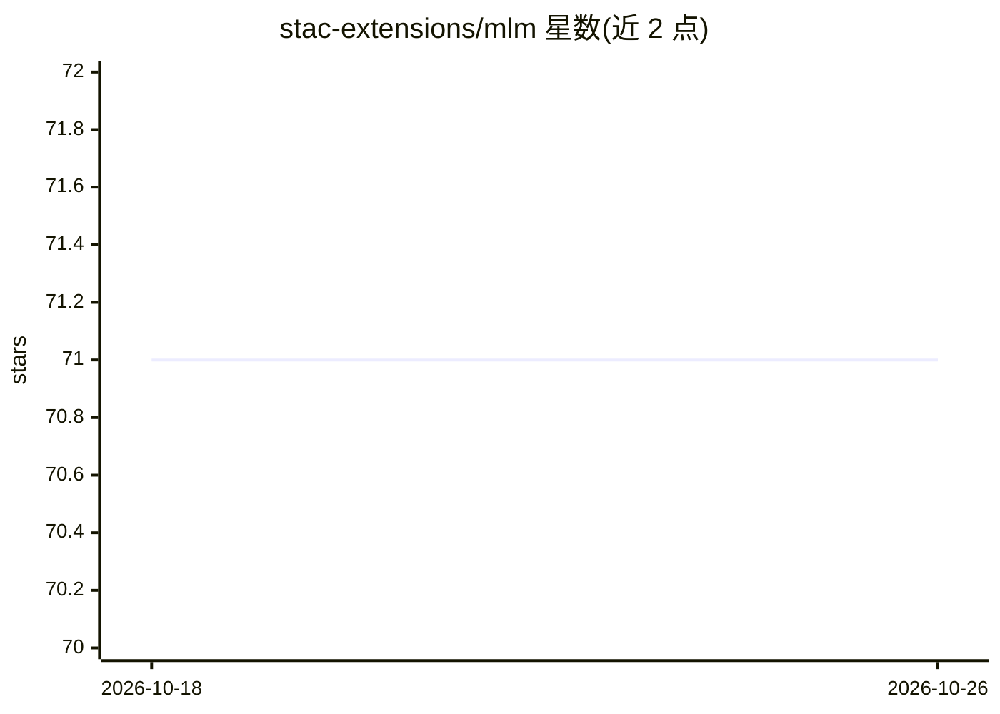

# stac-extensions/mlm

⭐ 71 · Python · Apache-2.0 · 推送 2026-10-24 · [GitHub](https://github.com/stac-extensions/mlm) · [官网](https://stac-extensions.github.io/mlm/) · 组织维护

**描述机器学习模型元数据的 STAC 扩展规范（遥感影像模型编目）**

STAC MLM 是一个元数据扩展规范，为训练于遥感/俯视影像的机器学习模型定义标准化字段：模型架构、任务、框架、加速器与内存要求、输入/输出变换与形状、超参数、预训练来源、训练数据集交叉引用与论文引用，使模型可作为 STAC Collection/Item 被搜索和复用，并记录部署推理服务所需信息。规范偏向监督学习但相关字段可选。提供 JSON Schema、pystac 官方集成（v1.13.0 起）与 stac-model Pydantic 包。前身 DLM/ml-model 扩展已合并重构。

## 筛选速览

| 维度 | 判定 | 备注 |
|---|---|---|
| AI 角色 | `ai-ecosystem` | LLM/agent 周边工具 |
| 许可风险 | `permissive` | Apache-2.0 |
| 部署形态 | `self-host` | docker 或自建部署 |
| 模型依赖 | — | README 未给出锁定关系 |
| 硬件要求 | — | 无带数字的原话,不猜 |
| 安装摩擦 | `low` | 无编译、无系统依赖或容器化 |
| 成熟度 | `idea` | |

## 能力要点

- 定义 mlm:name/architecture/tasks/input/output 等标准化模型元数据字段
- 记录加速器类型/数量/内存大小等推理运行时要求
- 官方 pystac 集成（v1.13.0 起）与 stac-model Pydantic 实现
- 包含 scene-classification、object-detection、semantic-segmentation 任务示例

## 适用场景

- 将地学 ML 模型编目为 STAC 条目，与关联数据集一同检索
- 记录模型部署推理所需的波段、预处理与硬件信息
- 构建可跨目录发现和复用的模型集合

## 场景标签

 · 领域:地理空间/ML 元数据规范

## 证据(README 行号)

> L20: The STAC Machine Learning Model (MLM) extension provides a standard set of fields to describe machine learning mode
> L25: 1) to enable building model collections that can be searched alongside associated STAC datasets
> L34: 4. Flexible description of the runtime environment to be able to run the model

## 星数曲线

2026-10-18 71 → 2026-10-26 71（+0）

---
*卡片 v1 · prompt 1.4 · 生成 2026-10-24 · 置信度 mid · 依据 README sha `59303e649b3c` · [字段定义](../../DATASET.md)*
