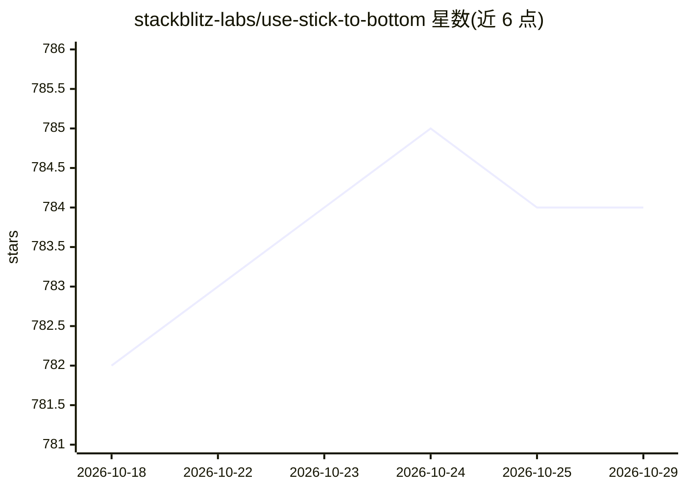

# stackblitz-labs/use-stick-to-bottom

⭐ 784 · TypeScript · MIT · 推送 2026-06-04 · [GitHub](https://github.com/stackblitz-labs/use-stick-to-bottom) · [官网](https://use-stick-to-bottom.samdenty.io/) · 个人维护

**面向 AI 聊天界面的 React 吸底滚动 Hook**

零依赖的 React Hook 与组件库，使容器在新增内容时自动吸附底部并平滑动画保持视觉位置，主要面向流式输出内容的 AI 聊天应用。基于 ResizeObserver 检测内容尺寸变化，支持内容收缩时保持吸附、正确处理滚动锚定、用户上滚即取消吸附，采用基于速度的弹簧动画算法（参数可配置），scrollToBottom 返回 Promise 表示滚动是否成功。提供组件与 Hook 两种使用方式，组件内子组件可查询 isAtBottom 并编程式滚动。

## 筛选速览

| 维度 | 判定 | 备注 |
|---|---|---|
| AI 角色 | `ai-ecosystem` | LLM/agent 周边工具 |
| 许可风险 | `permissive` | MIT |
| 部署形态 | `library` | 以包/库形式分发 |
| 模型依赖 | — | README 未给出锁定关系 |
| 硬件要求 | — | 无带数字的原话,不猜 |
| 安装摩擦 | `low` | 无编译、无系统依赖或容器化 |
| 成熟度 | — | 结构信号不足 |

## 能力要点

- 零依赖，ResizeObserver 检测内容尺寸变化
- 基于速度的弹簧动画平滑滚动，参数可配置
- 区分用户滚动与动画滚动，用户上滚即取消吸附
- 支持内容收缩时保持吸底，正确处理 Scroll Anchoring

## 适用场景

- AI 聊天应用流式输出消息时保持视图吸底
- 聊天列表中让用户上滚浏览历史、回到底部时恢复吸底
- 在现有组件中通过 ref 接入吸底行为

## 场景标签

 · 领域:前端/聊天界面组件

## 证据(README 行号)

> L3: > Designed with AI chat bots in mind
> L11: A lightweight **zero-dependency** React hook + Component that automatically sticks to the bottom of container and s

## 星数曲线

2026-10-18 782 → 2026-10-29 784（+2）

---
*卡片 v1 · prompt 1.4 · 生成 2026-10-21 · 置信度 high · 依据 README sha `47c81f892ec6` · [字段定义](../../DATASET.md)*
