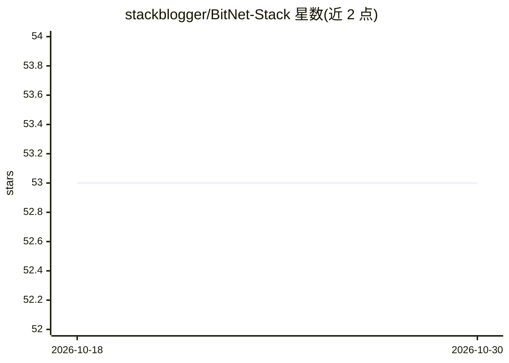

# stackblogger/BitNet-Stack

⭐ 53 · HTML · MIT · 推送 2026-04-19 · [GitHub](https://github.com/stackblogger/BitNet-Stack) · [官网](https://opensource.stackblogger.com/BitNet-Stack/) · 个人维护

**一条 Docker 命令本地运行 BitNet 模型并在浏览器对话**

面向本地部署者的 BitNet 1bit LLM 运行套件：通过 git clone 与 docker compose up 一条命令构建镜像并启动 LLM 服务器（模型在镜像构建期间自动下载），随后在浏览器访问 localhost:5001 使用聊天界面。Web UI 支持流式输出、上下文感知的连续对话、浏览器本地持久化的聊天历史与一键清除。唯一前置依赖为 Docker（含 Docker Compose），端口可在 docker-compose.yml 中修改。MIT 许可。

## 筛选速览

| 维度 | 判定 | 备注 |
|---|---|---|
| AI 角色 | `ai-native` | 本体是模型或模型工具 |
| 许可风险 | `permissive` | MIT |
| 部署形态 | `self-host` | docker 或自建部署 |
| 模型依赖 | — | README 未给出锁定关系 |
| 硬件要求 | — | 无带数字的原话,不猜 |
| 安装摩擦 | `low` | 无编译、无系统依赖或容器化 |
| 成熟度 | — | 结构信号不足 |

## 能力要点

- 单条 docker compose 命令启动 LLM 服务器，模型随镜像构建自动下载
- 浏览器 Web UI 支持流式输出与连续对话（上下文感知）
- 聊天历史保存在浏览器中，刷新后保留，可一键清除

## 适用场景

- 在本地机器快速跑起 BitNet 小模型并与它对话
- 无需手动配置模型环境，用 Docker 一键体验 1bit LLM

## 场景标签

`聊天机器人` · 领域:对话与助手

## 证据(README 行号)

> L7: Run a small BitNet model on local machine with one Docker command, and chat in browser.
> L11: - Start the LLM server with a single command

## 星数曲线

2026-10-18 53 → 2026-10-30 53（+0）

---
*卡片 v1 · prompt 1.4 · 生成 2026-10-24 · 置信度 mid · 依据 README sha `98f7a02da261` · [字段定义](../../DATASET.md)*
