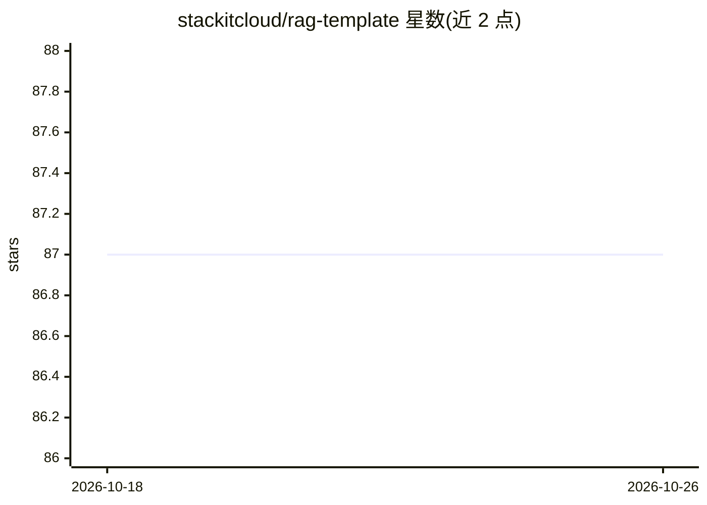

# stackitcloud/rag-template

⭐ 87 · Python · Apache-2.0 · 推送 2026-10-25 · [GitHub](https://github.com/stackitcloud/rag-template) · [官网](https://www.stackit.de/en/) · 组织维护

**STACKIT 维护的 RAG 应用模板：构建 AI 聊天与文档管理**

由 STACKIT 维护的 RAG 项目模板，演示如何基于 rag-core-api 等 Python 库构建带文档管理的 AI 聊天系统。包含 rag-backend（连接向量数据库与聊天）、admin-backend（管理文档与 Confluence 空间，使用 S3 存储）、document-extractor（Docling/MarkItDown/自定义抽取器的确定性回退链，支持 PDF、Office、EPUB 等格式）、MCP server、前端与 Helm/Kubernetes 基础设施。支持 STACKIT 与 Ollama 等 LLM 提供商，集成 Langfuse 监控，本地部署依赖 k3d、helm、tilt，通过 Tiltfile 启动。

## 筛选速览

| 维度 | 判定 | 备注 |
|---|---|---|
| AI 角色 | `ai-ecosystem` | LLM/agent 周边工具 |
| 许可风险 | `permissive` | Apache-2.0 |
| 部署形态 | `self-host` | docker 或自建部署 |
| 模型依赖 | local-ok | 支持本地模型 |
| 硬件要求 | — | 无带数字的原话,不猜 |
| 安装摩擦 | `low` | 无编译、无系统依赖或容器化 |
| 成熟度 | — | 结构信号不足 |

## 能力要点

- 多组件架构：rag-backend/admin-backend/document-extractor/MCP server/前端
- 文档抽取含 Docling/MarkItDown/自定义抽取器的确定性回退链
- 支持 STACKIT 与 Ollama 等多种 LLM 提供商
- 提供 Helm chart 与 Kubernetes 部署配置，本地用 Tilt+k3d 启动

## 适用场景

- 快速搭建带文档管理与聊天界面的 RAG 应用
- 部署基于自有文档的问答系统到 Kubernetes 环境
- 通过 MCP 客户端访问 RAG 系统的问答能力

## 场景标签

`RAG` · 领域:知识与检索

## 证据(README 行号)

> L45: Welcome to the STACKIT RAG Template! This is a basic example of how to use the RAG-API libraries, designed to help 
> L62: The template supports multiple LLM (Large Language Model) providers, such as STACKIT and Ollama, giving you flexibi

## 星数曲线

2026-10-18 87 → 2026-10-26 87（+0）

---
*卡片 v1 · prompt 1.4 · 生成 2026-10-23 · 置信度 mid · 依据 README sha `560ea0ff455d` · [字段定义](../../DATASET.md)*
