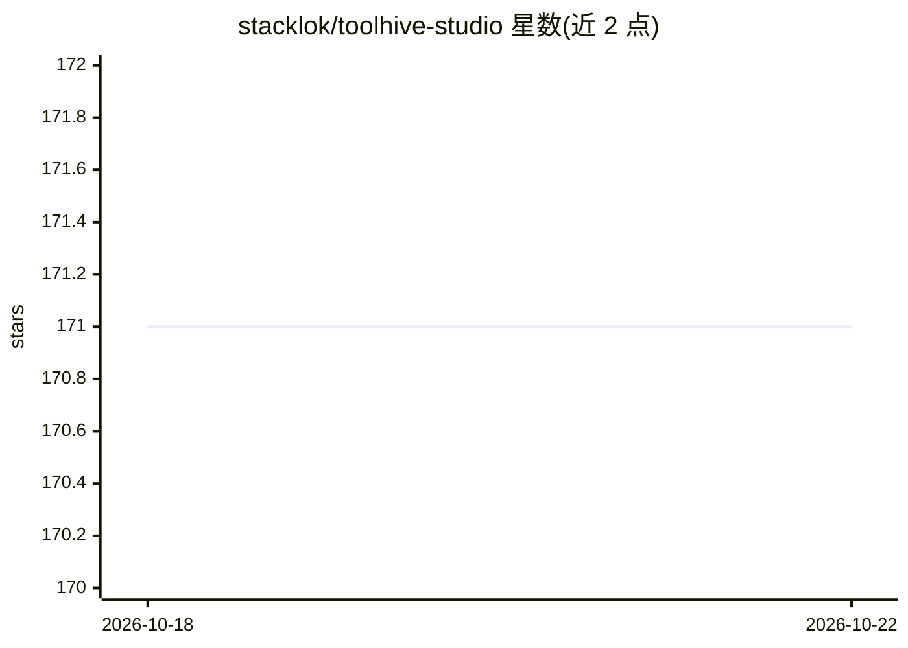

# stacklok/toolhive-studio

⭐ 171 · TypeScript · Apache-2.0 · 推送 2026-10-20 · [GitHub](https://github.com/stacklok/toolhive-studio) · [官网](https://stacklok.com/download/) · 组织维护

**桌面应用：安全容器化安装、运行与管理 MCP 服务器**

ToolHive 的桌面 UI，面向需要部署 MCP 服务器的用户：以图形化工作流发现、安装并启动任意 MCP 服务器，每个服务器运行在独立受限容器中，通过 HTTP/SSE 代理供 MCP 客户端连接，并自动配置 GitHub Copilot、Cursor、Claude Code 等客户端。密钥安全托管，不落明文。支持 Windows/macOS/Linux，另有 CLI 与 Kubernetes Operator 形态。默认启用 Sentry 遥测（错误、性能、使用模式），可在设置中关闭。

## 筛选速览

| 维度 | 判定 | 备注 |
|---|---|---|
| AI 角色 | `ai-ecosystem` | LLM/agent 周边工具 |
| 许可风险 | `permissive` | Apache-2.0 |
| 部署形态 | `None` |  |
| 模型依赖 | — | README 未给出锁定关系 |
| 硬件要求 | — | 无带数字的原话,不猜 |
| 安装摩擦 | `low` | 无编译、无系统依赖或容器化 |
| 成熟度 | — | 结构信号不足 |

## 能力要点

- 图形化工作流一键启动任意 MCP 服务器
- 每个 MCP 服务器运行在独立隔离容器，密钥安全托管
- 通过 HTTP/SSE 代理供 MCP 客户端连接
- 自动配置 GitHub Copilot、Cursor、Claude Code 等客户端

## 适用场景

- 在桌面上一键安装并运行 MCP 服务器
- 以容器隔离方式降低运行 MCP 服务器的安全风险
- 将 MCP 服务器接入 Cursor、Claude Code 等客户端

## 场景标签

 · 领域:AI 基础设施/MCP 管理

## 证据(README 行号)

> L12: ToolHive is the easiest way to discover, deploy, and manage MCP servers. Launch
> L48: Under the hood, ToolHive runs each MCP server in its own secure container and

## 星数曲线

2026-10-18 171 → 2026-10-22 171（+0）

---
*卡片 v1 · prompt 1.4 · 生成 2026-10-22 · 置信度 high · 依据 README sha `6977b1899a46` · [字段定义](../../DATASET.md)*
