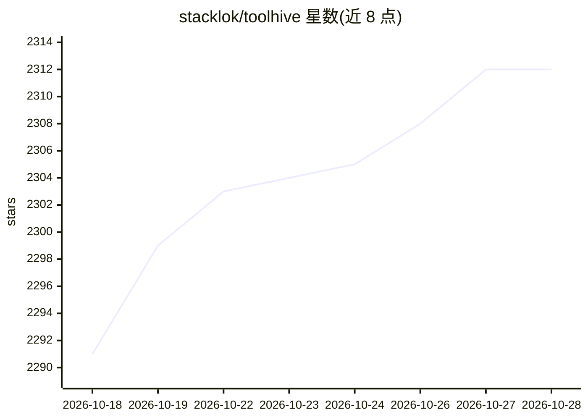

# stacklok/toolhive

⭐ 2,313 · Go · Apache-2.0 · 推送 2026-10-28 · [GitHub](https://github.com/stacklok/toolhive) · [官网](https://stacklok.com/download/) · 组织维护

**企业级 MCP 服务器运行与管理平台**

由 Stacklok 维护的开源平台，用于安全运行和管理 Model Context Protocol (MCP) 服务器：以 Gateway、Registry Server 与 Runtime 三模块组成，将每个 MCP 服务器置于隔离容器中运行，可本地（Docker/Podman）或通过 Kubernetes Operator 部署，提供按请求的身份与访问策略、审计日志、OTel/Prometheus 监控、OIDC/OAuth SSO 集成及语义化工具搜索。提供跨平台桌面 UI 与 CLI 两种界面，可将受管 MCP 服务器自动接入 Claude Desktop、Cursor、VS Code 等 AI 客户端。

## 筛选速览

| 维度 | 判定 | 备注 |
|---|---|---|
| AI 角色 | `ai-ecosystem` | LLM/agent 周边工具 |
| 许可风险 | `permissive` | Apache-2.0 |
| 部署形态 | `None` |  |
| 模型依赖 | — | README 未给出锁定关系 |
| 硬件要求 | — | 无带数字的原话,不猜 |
| 安装摩擦 | `low` | 无编译、无系统依赖或容器化 |
| 成熟度 | — | 结构信号不足 |

## 能力要点

- MCP 服务器隔离容器化运行，本地或 Kubernetes 均可部署
- Gateway 集中安全策略、认证授权、审计与工具过滤
- Registry Server 策展可信 MCP 服务器目录并验证签名来源
- 提供桌面 UI 与 CLI，支持自动连接 AI 客户端

## 适用场景

- 平台团队在现有 Kubernetes 基础设施上运行 MCP
- 企业自托管 MCP 注册表与网关以满足合规要求
- 开发者通过桌面 UI 或 CLI 一键运行 MCP 服务器

## 场景标签

 · 领域:AI 基础设施/MCP 管理

## 证据(README 行号)

> L12: ToolHive runs every MCP server in an isolated container, enforces identity and access policy per request when confi
> L97: 2. **Users** discover, configure, and run MCP servers through **ToolHive UI** or the **CLI**, and ToolHive orchestr

## 星数曲线

2026-10-18 2,291 → 2026-10-28 2,312（+21）

---
*卡片 v1 · prompt 1.4 · 生成 2026-10-21 · 置信度 high · 依据 README sha `316dbc468c59` · [字段定义](../../DATASET.md)*
