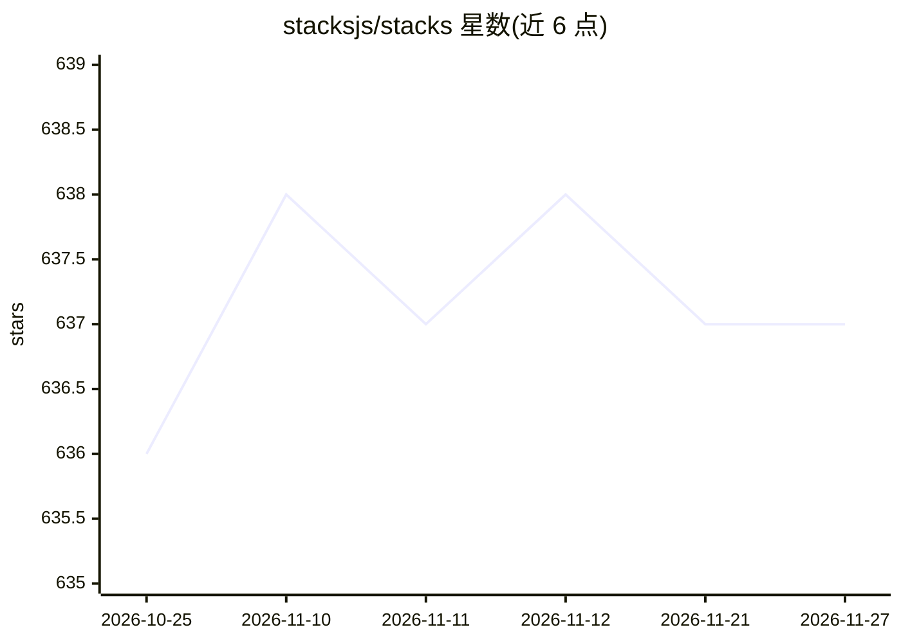

# stacksjs/stacks

⭐ 637 · TypeScript · MIT · 推送 2026-11-26 · [GitHub](https://github.com/stacksjs/stacks) · [官网](https://stacksjs.com) · 组织维护

**给全栈开发者的快速应用/库/云开发框架**

Stacks 是一个约定优于配置的全栈 TypeScript 开发框架，覆盖前端组件与路由、后端 serverless/传统 API、ORM 与数据库、云基础设施管理及 CI/CD 发布，通过统一的 Buddy CLI 驱动 dev/build/test/migrate 等日常流程。运行前提是通过 Pantry 工具链自动配置 Bun、Git、SQLite 等，目前要求 macOS、Linux 或 WSL 环境，Windows 原生支持在路线图中。框架内含 AI 相关引擎（agentic 工作流集成、用应用数据微调基础模型、LLM 友好创作），并提供供 Claude Code、Codex、Cursor 使用的 agent skills。

## 筛选速览

| 维度 | 判定 | 备注 |
|---|---|---|
| AI 角色 | `ai-enhanced` | 去掉 AI 部分产品仍成立 |
| 许可风险 | `permissive` | MIT |
| 部署形态 | `None` |  |
| 模型依赖 | — | README 未给出锁定关系 |
| 硬件要求 | — | 无带数字的原话,不猜 |
| 安装摩擦 | `low` | 无编译、无系统依赖或容器化 |
| 成熟度 | `idea` | |

## 能力要点

- 单一 Buddy CLI 覆盖开发、构建、测试、迁移、部署流程
- 前端/后端/云基础设施/CI-CD 多引擎一体框架
- 支持 Web 与桌面应用（含系统托盘应用）
- 提供供 Claude Code、Codex、Cursor 使用的 agent skills 与 LLM 友好创作模式

## 适用场景

- 用一套框架快速搭建 Web 与桌面全栈应用
- 以约定优于配置方式创建和维护云基础设施
- 构建框架无关的组件与函数库并自动发布

## 场景标签

 · 领域:开发框架/全栈开发工具

## 证据(README 行号)

> L15: Stacks is a rapid development framework, where the goal is to _help you_ create & maintain frontends, backends, and
> L128: - 🪄 **AI** _deep AI integrations to simplify building agentic workflow_
> L157: - 🤖 **AI** _fine-tune a foundational model using your application data_

## 星数曲线

2026-10-25 636 → 2026-11-27 637（+1）

---
*卡片 v1 · prompt 1.4 · 生成 2026-11-24 · 置信度 high · 依据 README sha `7250d188763e` · [字段定义](../../DATASET.md)*
