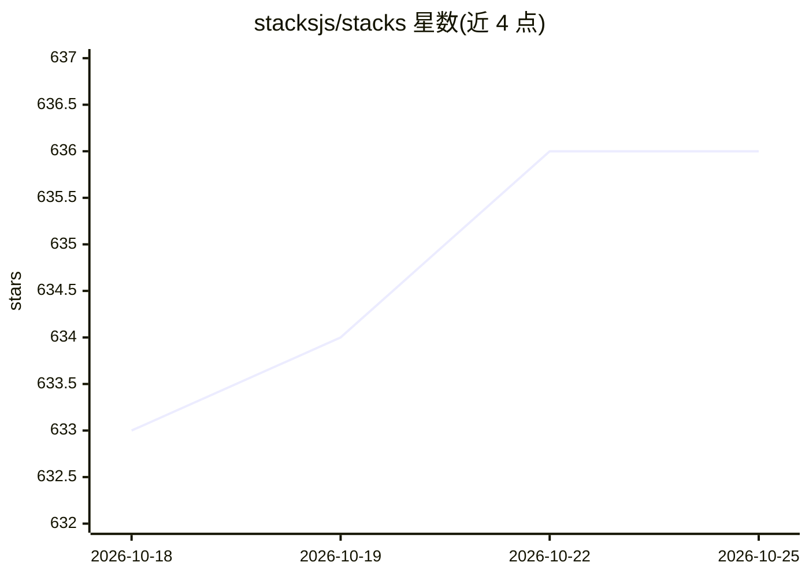

# stacksjs/stacks

⭐ 636 · TypeScript · MIT · 推送 2026-10-24 · [GitHub](https://github.com/stacksjs/stacks) · [官网](https://stacksjs.com) · 组织维护

**TypeScript 全栈应用与库的快速开发框架**

面向 TypeScript 开发者的全栈开发框架，覆盖前端 UI（组件、路由、桌面打包）、后端（API、ORM、队列、缓存、多数据库）与云基础设施（Serverless、CDN、IaC）及 CI/CD 部署，通过 buddy CLI 统一操作，采用约定优于配置。AI 能力作为引擎之一提供：后端 agentic 工作流集成、云端用应用数据微调基础模型、LLM 友好作者化。前置依赖 Pantry 工具链（安装 Bun/Git/SQLite），要求 macOS/Linux/WSL，尚处 1.0 前活跃开发期。

## 筛选速览

| 维度 | 判定 | 备注 |
|---|---|---|
| AI 角色 | `ai-enhanced` | 去掉 AI 部分产品仍成立 |
| 许可风险 | `permissive` | MIT |
| 部署形态 | `None` |  |
| 模型依赖 | — | README 未给出锁定关系 |
| 硬件要求 | — | 无带数字的原话,不猜 |
| 安装摩擦 | `low` | 无编译、无系统依赖或容器化 |
| 成熟度 | `idea` | |

## 能力要点

- 前端/后端/云/CI-CD 四类引擎覆盖全栈开发
- buddy 单一 CLI 承担开发、构建、迁移、脚手架等日常操作
- 后端 AI 引擎支持 agentic 工作流，云端支持用应用数据微调基础模型
- LLM-Friendly Authoring：模型生成紧凑应用意图而非框架胶水代码

## 适用场景

- 用 TypeScript 快速搭建全栈 Web 或桌面应用
- 维护从本地开发到云基础设施部署的完整流程
- 构建带 agentic AI 工作流的全栈应用
- 开发并自动发布框架无关的组件与函数库

## 场景标签

 · 领域:Web/全栈开发框架

## 证据(README 行号)

> L15: Stacks is a rapid development framework, where the goal is to _help you_ create & maintain frontends, backends, and
> L128: - 🪄 **AI** _deep AI integrations to simplify building agentic workflow_
> L176: - 🧠 **LLM-Friendly Authoring** _models generate compact application intent instead of repeating framework glue or 

## 星数曲线

2026-10-18 633 → 2026-10-25 636（+3）

---
*卡片 v1 · prompt 1.4 · 生成 2026-10-21 · 置信度 high · 依据 README sha `3e4c9a6d1d75` · [字段定义](../../DATASET.md)*
