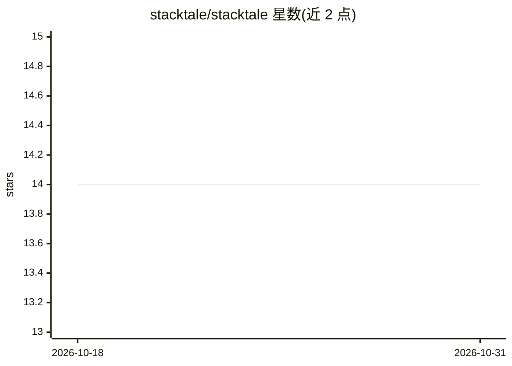

# stacktale/stacktale

⭐ 14 · Java · Apache-2.0 · 推送 2026-10-29 · [GitHub](https://github.com/stacktale/stacktale) · [官网](https://stacktale.github.io/stacktale/) · 个人维护

**把 Java 错误日志转成 AI 可读报告的 Logback/Log4j2/JUL appender**

面向 Java/Kotlin 开发者的日志组件：以 Logback appender（另有 Log4j2、JUL、Spring Boot starter、JUnit 监听器等形态）在日志写入时捕获错误上下文，将堆栈蒸馏为紧凑的 st/1 结构化报告，写入 errors-ai.log 供 AI 助手或 agent 读取。报告保留事故前的相关日志行（story）、MDC、异常字段与环境信息，重复框架帧折叠为计数，原始日志不受影响。默认对 JWT、bearer token 等常见敏感信息脱敏；repro 复现种子功能默认关闭。要求 Java 17+，制品发布于 Maven Central。

## 筛选速览

| 维度 | 判定 | 备注 |
|---|---|---|
| AI 角色 | `ai-ecosystem` | LLM/agent 周边工具 |
| 许可风险 | `permissive` | Apache-2.0 |
| 部署形态 | `None` |  |
| 模型依赖 | — | README 未给出锁定关系 |
| 硬件要求 | — | 无带数字的原话,不猜 |
| 安装摩擦 | `medium` | 含编译或系统依赖之一 |
| 成熟度 | — | 结构信号不足 |

## 能力要点

- 错误发生时在源头捕获 story、MDC、异常字段与环境信息，输出单块结构化报告
- 重复框架帧折叠为带标签计数， culprit 帧与 wrapped by 链保留
- 支持 Logback/Log4j2/JUL/Spring Boot 零配置 starter，任一 SLF4J 语言的 Kotlin 等同使用
- stacktale-junit 将失败测试也转为报告；默认脱敏 JWT/bearer token 等常见敏感信息

## 适用场景

- 把生产错误的 errors-ai.log 交给 AI 助手或 agent 做排查
- 让 agent 拿到含类名、参数类型与失败值的复现种子来自动写测试
- 在 Spring Boot 项目中零配置获得面向 AI 的错误报告

## 场景标签

 · 领域:开发者工具/日志

## 证据(README 行号)

> L13: A Logback appender that turns Java errors into **AI-ready reports**. Add one dependency —
> L15: `errors-ai.log`, shaped for a reader that increasingly triages your errors: an AI

## 星数曲线

2026-10-18 14 → 2026-10-31 14（+0）

---
*卡片 v1 · prompt 1.4 · 生成 2026-10-31 · 置信度 high · 依据 README sha `c01dde71f9bb` · [字段定义](../../DATASET.md)*
