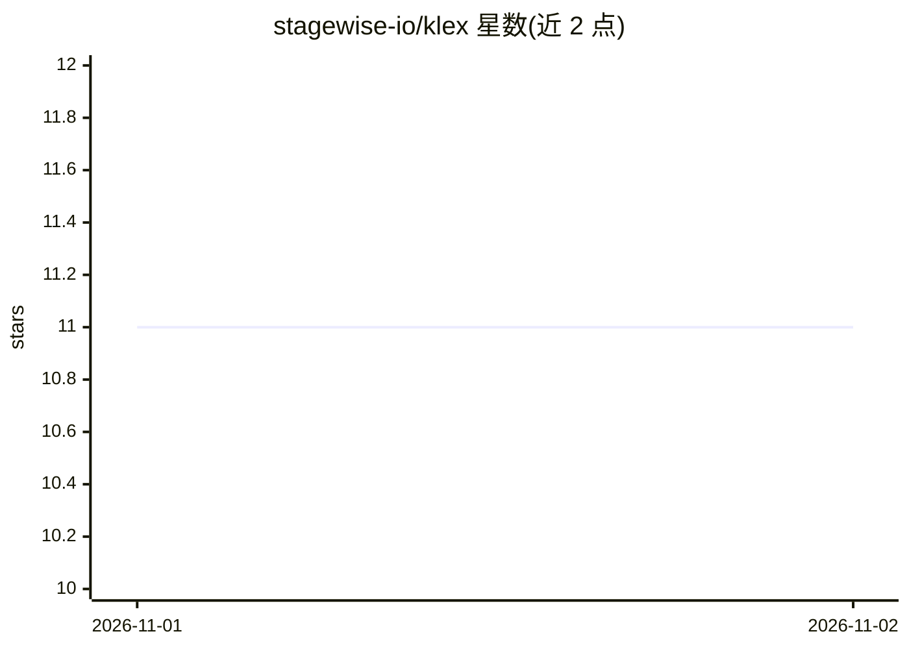

# stagewise-io/klex

⭐ 11 · TypeScript · Apache-2.0 · 推送 2026-11-01 · [GitHub](https://github.com/stagewise-io/klex) · [官网](https://klex.bot) · 组织维护

**可自托管、模型无关的自治数字同事 bot 框架**

Klex 提供隔离运行、可观测的自治 agent bot，通过 MCP 连接工具、机器与编码环境。核心机制包括：单一持久会话（所有消息进入同一上下文）、mcp-native 架构（消息经实现推送通知扩展的 MCP 服务器传入，实时通话经 realtime-media 扩展）、运行时仅访问独立 data-directory 的隔离设计，以及每轮工作后反思并将经验组织为技能的自我改进机制。安装提供 curl/PowerShell 脚本，可连接 Klex Cloud 获取应用集成与推送通知，也可纯本地运行（需自行配置反向代理接收 webhook）。支持语音通话（目前实时协议仅支持 LiveKit）。面向需要自托管 AI 协作者的开发者与团队。

## 筛选速览

| 维度 | 判定 | 备注 |
|---|---|---|
| AI 角色 | `ai-ecosystem` | LLM/agent 周边工具 |
| 许可风险 | `permissive` | Apache-2.0 |
| 部署形态 | `None` |  |
| 模型依赖 | — | README 未给出锁定关系 |
| 硬件要求 | — | 无带数字的原话,不猜 |
| 安装摩擦 | `low` | 无编译、无系统依赖或容器化 |
| 成熟度 | — | 结构信号不足 |

## 能力要点

- 基于 MCP 的 agent 架构，消息经 mcp-extension-push-notifications 传入
- 运行时仅访问独立 data-directory，外部连接全部经 MCP 建立
- 每轮工作后反思并生成技能以自我改进
- 内置实时语音通话（目前实时协议仅支持 LiveKit）

## 适用场景

- 搭建可自托管、数据与 API key 留在本地的自治 AI 同事
- 通过 Slack 等 bot 身份接收 DM/@mention 唤醒执行任务
- 连接 MCP 服务器扩展工具与机器操作能力

## 场景标签

`Agent 框架` · 领域:Agent 开发

## 证据(README 行号)

> L3: Isolated, observable, autonomous bots that **excel at memory and self-improvement**. Tools, machines and coding envi
> L42: ### Klex bots are *mcp-native*

## 星数曲线

2026-11-01 11 → 2026-11-02 11（+0）

---
*卡片 v1 · prompt 1.4 · 生成 2026-11-01 · 置信度 mid · 依据 README sha `2be7e8e1eded` · [字段定义](../../DATASET.md)*
