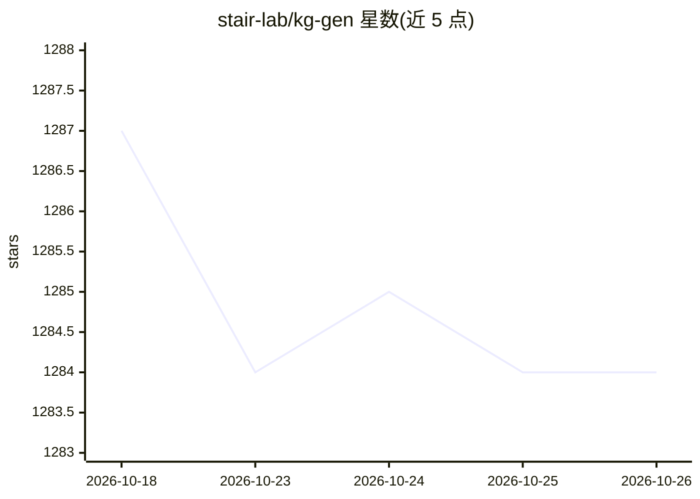

# stair-lab/kg-gen

⭐ 1,284 · Python · 推送 2026-03-24 · [GitHub](https://github.com/stair-lab/kg-gen) · [官网](https://kg-gen.org) · 组织维护

**用 LLM 从任意文本抽取知识图谱的 Python 库**

kg-gen 是一个 Python 库，调用大语言模型从纯文本或对话消息中抽取实体与关系，生成知识图谱，支持大文本分块（chunk_size）处理、实体/关系聚类、多图聚合与可视化。模型调用经 LiteLLM 路由，可接入 OpenAI、Ollama、Anthropic、Gemini、DeepSeek 等 API 或本地模型，并用 DSPy 做结构化输出。附带 MCP Server 供 AI agent 作持久记忆使用，附 KG 基准 MINE 的实验说明。MIT 许可，NeurIPS '25 论文随附。

## 筛选速览

| 维度 | 判定 | 备注 |
|---|---|---|
| AI 角色 | `ai-native` | 本体是模型或模型工具 |
| 许可风险 | `none` | — |
| 部署形态 | `library` | 以包/库形式分发 |
| 模型依赖 | local-ok | 支持本地模型 |
| 硬件要求 | — | 无带数字的原话,不猜 |
| 安装摩擦 | `low` | 无编译、无系统依赖或容器化 |
| 成熟度 | — | 结构信号不足 |

## 能力要点

- 支持纯文本与对话消息两种输入，保留角色信息抽取跨消息关系
- 大文本分块处理、实体与关系聚类、多图聚合
- 模型调用经 LiteLLM 路由，支持 API 与本地模型，可自定义 base_url
- 提供 MCP Server（kggen mcp）供 AI agent 使用

## 适用场景

- 为 RAG 系统构建知识图谱
- 生成图结构合成数据用于模型训练与测试
- 分析文本中概念间的关系并可视化

## 场景标签

`知识图谱` · 领域:知识与检索

## 证据(README 行号)

> L5: Welcome! `kg-gen` helps you extract knowledge graphs from any plain text using AI. It can process both small and lar
> L13: We support API-based and local model providers via LiteLLM, including OpenAI, Ollama, Anthropic, Gemini, Deepseek, 

## 星数曲线

2026-10-18 1,287 → 2026-10-26 1,284（-3）

---
*卡片 v1 · prompt 1.4 · 生成 2026-10-22 · 置信度 high · 依据 README sha `2b515d112218` · [字段定义](../../DATASET.md)*
