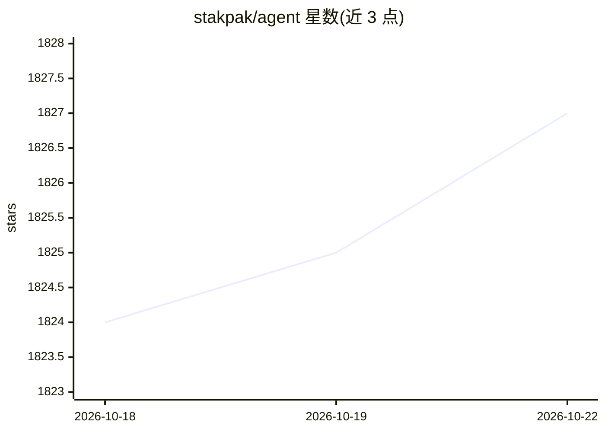

# stakpak/agent

⭐ 1,827 · Rust · Apache-2.0 · 推送 2026-07-06 · [GitHub](https://github.com/stakpak/agent) · [官网](https://stakpak.dev) · 组织维护

**常驻本机的自主 DevOps AI agent，24/7 运维并生成基础设施代码**

开源命令行 agent（Rust/🦀），以 autopilot 模式常驻用户机器，执行基础设施代码生成、Kubernetes 调试、CI/CD 配置与部署自动化。安全机制包括密文替换（LLM 不见凭证明文）、网络级 Warden 策略拦截、mTLS 加密 MCP 与隐私脱敏。支持 Anthropic/OpenAI API key、本地 OpenAI 兼容端点（Ollama/LM Studio）或 Stakpak 自有 API key；可作 MCP 服务器/代理，并经 ACP 协议接入 Zed 编辑器。前提：本机需安装 Docker，建议 2GB+ 内存。

## 筛选速览

| 维度 | 判定 | 备注 |
|---|---|---|
| AI 角色 | `ai-native` | 本体是模型或模型工具 |
| 许可风险 | `permissive` | Apache-2.0 |
| 部署形态 | `self-host` | docker 或自建部署 |
| 模型依赖 | local-ok | 支持本地模型 |
| 硬件要求 | — | 无带数字的原话,不猜 |
| 安装摩擦 | `low` | 无编译、无系统依赖或容器化 |
| 成熟度 | — | 结构信号不足 |

## 能力要点

- autopilot 生命周期命令（up/down/status/doctor）实现 24/7 后台自主运行
- 密文替换 + Warden 网络级护栏 + mTLS MCP 的安全机制
- 支持 BYOK（Anthropic/OpenAI）、本地 OpenAI 兼容端点（Ollama/LM Studio）与 Stakpak key
- MCP 服务器/代理模式与 ACP 协议接入 Zed 编辑器

## 适用场景

- 让 agent 常驻服务器自动处理部署与运维任务
- 生成 Terraform/Kubernetes/CI 配置并调试集群
- 通过 Slack/Telegram/Discord 接收通知并审批 agent 操作
- 以安全代理方式将 DevOps 工具暴露给 MCP 客户端

## 场景标签

`代码生成` `工作流自动化` · 领域:效率与自动化

## 证据(README 行号)

> L3: An open source agent that lives on your machines 24/7, keeps your apps running, and only pings when it needs a human
> L23: Generate infrastructure code, debug Kubernetes, configure CI/CD, automate deployments, without giving an LLM the ke

## 星数曲线

2026-10-18 1,824 → 2026-10-22 1,827（+3）

---
*卡片 v1 · prompt 1.4 · 生成 2026-10-21 · 置信度 mid · 依据 README sha `81a7e38e0a70` · [字段定义](../../DATASET.md)*
