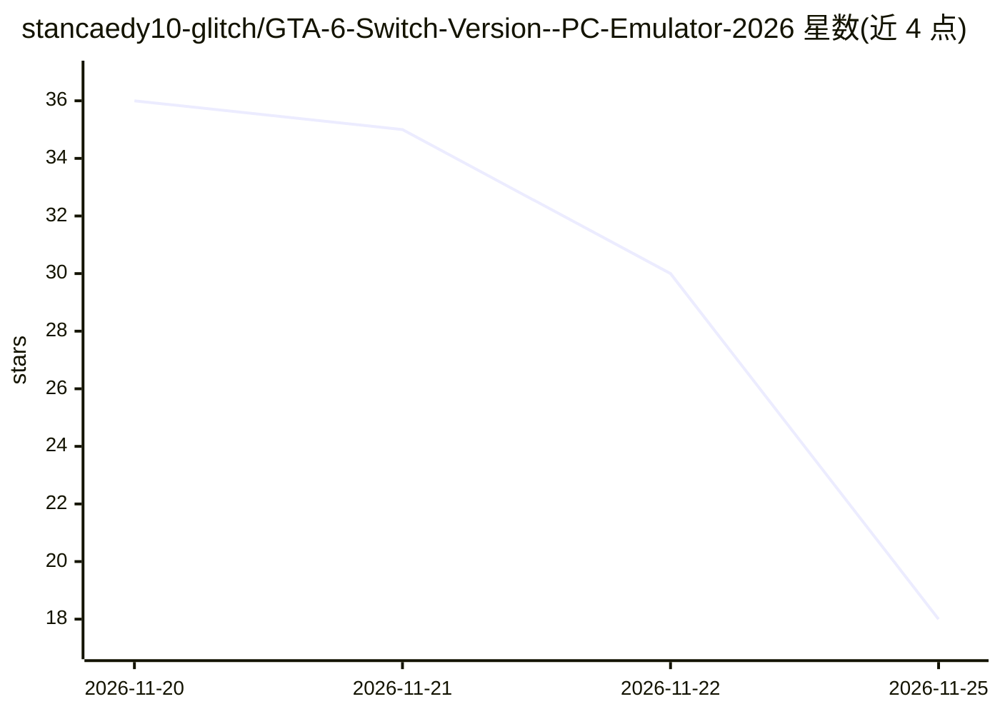

# stancaedy10-glitch/GTA-6-Switch-Version--PC-Emulator-2026

⭐ 18 · Rust · Apache-2.0 · 推送 2026-11-21 · [GitHub](https://github.com/stancaedy10-glitch/GTA-6-Switch-Version--PC-Emulator-2026) · 个人维护

**GTA VI PC 版 Windows 安装准备与优化指南及配套工具**

面向 Windows 10/11 用户的《GTA VI》PC 版安装与配置资源，内容涵盖 Windows 环境准备（系统更新、DirectX 检查、GPU 驱动验证、存储检查）、图形与 FPS 优化配置项说明、安装故障排查与 FAQ。自带一个 Windows 安装包作为配套工具（.exe），README 声明该安装包不含 GTA VI 游戏文件，游戏本体需在 PC 版正式发售时通过授权渠道获取。截至 README 所述日期，官方 PC 版发售日期与硬件要求均未公布，系统需求表全部标注未确认。

## 筛选速览

| 维度 | 判定 | 备注 |
|---|---|---|
| AI 角色 | `ai-enhanced` | 去掉 AI 部分产品仍成立 |
| 许可风险 | `permissive` | Apache-2.0 |
| 部署形态 | `desktop` | 安装包/桌面程序 |
| 模型依赖 | — | README 未给出锁定关系 |
| 硬件要求 | — | 无带数字的原话,不猜 |
| 安装摩擦 | `low` | 无编译、无系统依赖或容器化 |
| 成熟度 | `idea` | |

## 能力要点

- 提供 Windows 安装包形式的配套设置工具（不含游戏文件）
- 覆盖驱动验证、存储检查、DirectX 兼容性等安装前检查清单
- 列出常见性能问题（低 FPS/卡顿/显示/安装错误）的排查步骤
- 系统需求表标注官方 PC 要求尚未公布

## 适用场景

- 在 GTA VI PC 版发售前提前准备和检查我的 Windows 电脑
- 按指南更新显卡驱动和系统设置
- 排查 PC 游戏常见的低 FPS 和卡顿问题

## 场景标签

 · 领域:游戏/安装配置工具

## 证据(README 行号)

> L17: This repository is dedicated to Windows users preparing for the future PC edition of GTA VI.
> L34: The installer section is intended for a Windows setup companion associated with this project.
> L49: The companion installer does not contain or install GTA VI game files.

## 星数曲线

2026-11-20 36 → 2026-11-25 18（-18）

---
*卡片 v1 · prompt 1.4 · 生成 2026-11-22 · 置信度 low · 依据 README sha `2fe487426686` · [字段定义](../../DATASET.md)*
