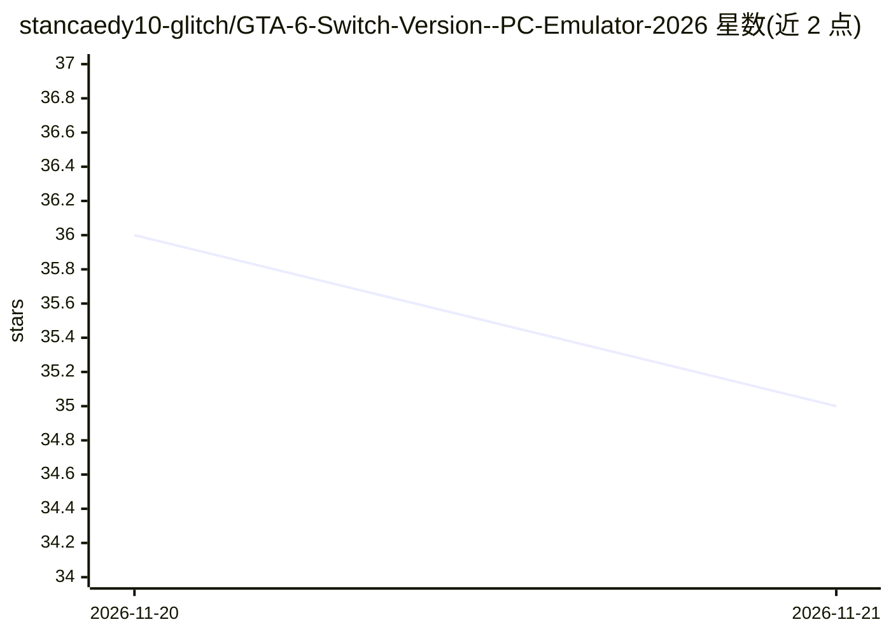

# stancaedy10-glitch/GTA-6-Switch-Version--PC-Emulator-2026

⭐ 35 · Go · Apache-2.0 · 推送 2026-11-19 · [GitHub](https://github.com/stancaedy10-glitch/GTA-6-Switch-Version--PC-Emulator-2026) · 个人维护

**GTA VI PC 版安装与配置指南资源页，面向 Windows 玩家**

面向 Windows 用户的 GTA VI PC 版安装准备与配置资料：覆盖 Windows 系统准备、显卡驱动更新、存储检查、Rockstar Games Launcher 准备、图形设置与 FPS 排障等通用 PC 游戏内容。README 自述不含 GTA VI 游戏文件，需通过授权渠道另行购买游戏；官方 PC 配置要求未公布，页面以待更新表格占位。主题标签含 ai/generative-ai/emulator，但正文无 AI 或模拟器功能的可验证描述。

## 筛选速览

| 维度 | 判定 | 备注 |
|---|---|---|
| AI 角色 | `ai-knowledge` | 知识聚合/清单类 |
| 许可风险 | `permissive` | Apache-2.0 |
| 部署形态 | `desktop` | 安装包/桌面程序 |
| 模型依赖 | — | README 未给出锁定关系 |
| 硬件要求 | — | 无带数字的原话,不猜 |
| 安装摩擦 | `low` | 无编译、无系统依赖或容器化 |
| 成熟度 | — | 结构信号不足 |

## 能力要点

- Windows 兼容性检查清单（系统版本、DirectX、驱动、存储）
- 面向 PC 游戏通用的图形与 FPS 优化说明
- 官方配置要求表格占位，标注尚未确认

## 适用场景

- 提前准备 Windows 环境等待 GTA VI PC 版发布
- 排查 PC 游戏常见卡顿、掉帧与安装报错

## 场景标签

 · 领域:游戏/安装配置指南

## 证据(README 行号)

> L5: A dedicated PC installation and configuration resource for Grand Theft Auto VI, covering Windows preparation, graphi
> L17: This repository is dedicated to Windows users preparing for the future PC edition of GTA VI.
> L49: The companion installer does not contain or install GTA VI game files.

## 星数曲线

2026-11-20 36 → 2026-11-21 35（-1）

---
*卡片 v1 · prompt 1.4 · 生成 2026-11-20 · 置信度 high · 依据 README sha `6954d37a13d3` · [字段定义](../../DATASET.md)*
