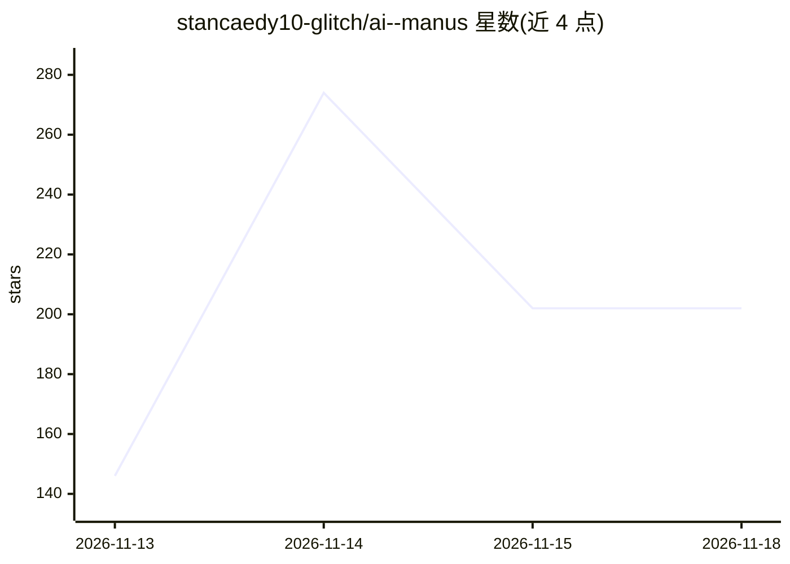

# stancaedy10-glitch/ai--manus

⭐ 202 · Apache-2.0 · 推送 2026-11-17 · [GitHub](https://github.com/stancaedy10-glitch/ai--manus) · 个人维护

**面向日常任务的自主 AI Agent：代用户运行代码与操控浏览器**

自主式 AI Agent 应用，面向家庭、学习与轻量办公场景的用户：代理执行代码编写与运行、浏览器操作（导航网页、填表、采集信息）及多步骤任务，可在后台作为个人助理待命，跨会话记忆工作流模式。README 未给出具体的安装命令、模型接入方式或技术栈细节，仅提供兼容性硬件参考（最低双核 CPU、4GB 内存）与使用步骤说明。定位为小规模任务的专注助手，非企业平台。

## 筛选速览

| 维度 | 判定 | 备注 |
|---|---|---|
| AI 角色 | `ai-native` | 本体是模型或模型工具 |
| 许可风险 | `permissive` | Apache-2.0 |
| 部署形态 | `None` |  |
| 模型依赖 | — | README 未给出锁定关系 |
| 硬件要求 | — | 无带数字的原话,不猜 |
| 安装摩擦 | `low` | 无编译、无系统依赖或容器化 |
| 成熟度 | — | 结构信号不足 |

## 能力要点

- 自主执行代码与脚本完成多步任务
- 浏览器控制：导航网页、填写表单、采集信息
- 后台待命的个人助理模式，跨会话复用工作流
- 代码与浏览器操作可在一个流程中衔接

## 适用场景

- 让学生整理研究笔记、跑快速计算
- 让代理代替我在多个网页间收集数据并汇总
- 把重复性的小型任务委托给后台代理处理

## 场景标签

`AI 助手` `浏览器自动化` · 领域:效率与自动化

## 证据(README 行号)

> L10: - **Autonomous Code Execution:** Manus AI agent runs code on its own to complete tasks, so you can focus on decisio
> L18: Manus is an autonomous AI agent designed to run code and control a browser on your behalf. Instead of acting like a

## 星数曲线

2026-11-13 146 → 2026-11-18 202（+56）

---
*卡片 v1 · prompt 1.4 · 生成 2026-11-18 · 置信度 mid · 依据 README sha `32e48e22fb91` · [字段定义](../../DATASET.md)*
