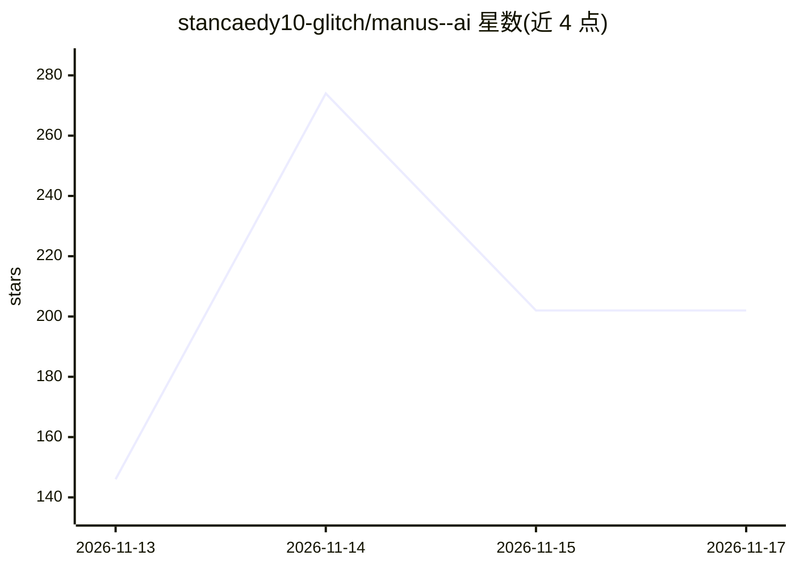

# stancaedy10-glitch/manus--ai

⭐ 202 · Apache-2.0 · 推送 2026-11-15 · [GitHub](https://github.com/stancaedy10-glitch/manus--ai) · 个人维护

**面向日常任务的自主 AI Agent：代用户执行代码与操控浏览器**

README 描述 Manus 为自主 AI agent，可在用户指令下编写并执行脚本、打开网页、与页面元素交互、执行多步任务，核心机制是代码执行与浏览器控制的结合（脚本内开始的任务可在浏览器中完成，反之亦然），并声称跨会话记住工作流模式。定位为家庭、学习与轻量办公场景的助手，而非企业平台。需注意：README 未给出任何实际安装命令、代码仓库内容或 API 接入方式，仅有下载入口与营销式描述，可验证的实现细节缺失。

## 筛选速览

| 维度 | 判定 | 备注 |
|---|---|---|
| AI 角色 | `ai-native` | 本体是模型或模型工具 |
| 许可风险 | `permissive` | Apache-2.0 |
| 部署形态 | `None` |  |
| 模型依赖 | — | README 未给出锁定关系 |
| 硬件要求 | — | 无带数字的原话,不猜 |
| 安装摩擦 | `low` | 无编译、无系统依赖或容器化 |
| 成熟度 | — | 结构信号不足 |

## 能力要点

- 自主执行代码与操控浏览器（导航网页、填写表单、抓取信息）
- 代码与浏览器操作在同一流程中衔接
- 面向多步任务，宣称可跨会话复用工作流模式

## 适用场景

- 让 agent 代跑脚本与整理研究资料
- 自动浏览网页填表与多页信息收集
- 处理日程提醒、文件整理等日常重复性小任务

## 场景标签

`浏览器自动化` `编码 Agent` `AI 助手` · 领域:效率与自动化

## 证据(README 行号)

> L10: - **Autonomous Code Execution:** Manus AI agent runs code on its own to complete tasks, so you can focus on decisio
> L18: Manus is an autonomous AI agent designed to run code and control a browser on your behalf. Instead of acting like a

## 星数曲线

2026-11-13 146 → 2026-11-17 202（+56）

---
*卡片 v1 · prompt 1.4 · 生成 2026-11-17 · 置信度 mid · 依据 README sha `0f78ee3a5dd2` · [字段定义](../../DATASET.md)*
