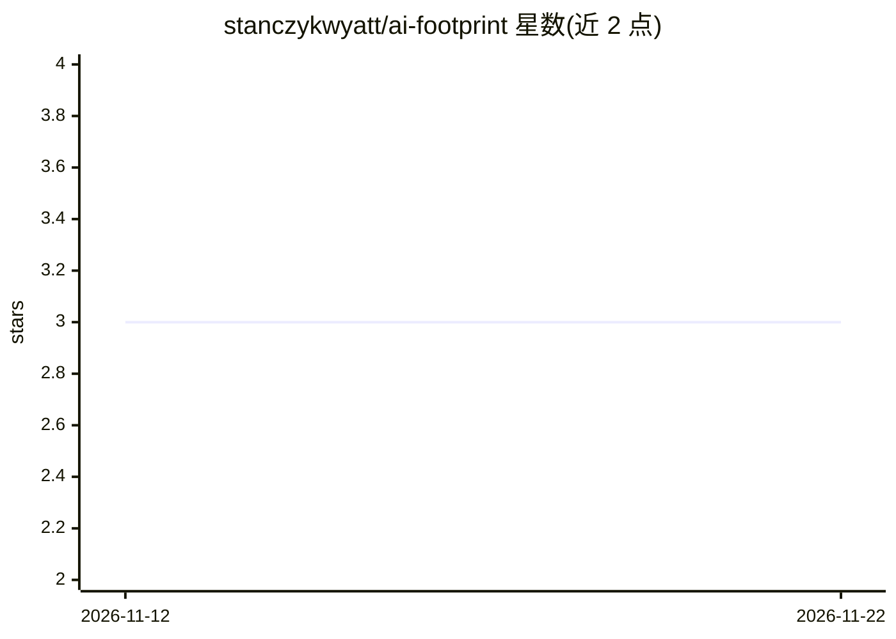

# stanczykwyatt/ai-footprint

⭐ 3 · Swift · MIT · 推送 2026-11-03 · [GitHub](https://github.com/stanczykwyatt/ai-footprint) · [官网](https://stanczykwyatt.github.io/ai-footprint/) · 个人维护

**Mac 菜单栏应用：查看 AI 编码工具占用的磁盘、进程与登录项**

面向 macOS 的免费开源菜单栏应用，聚合展示本机 AI 编码工具的足迹：按工具统计磁盘占用（模型/缓存/日志/转录/版本）、后台进程及其启动来源、MCP 服务器（含孤儿进程标记）与登录项。每 15 分钟或手动检查后，对版本变化、新装、登录项增减生成更新回执。App Sandbox 内只读运行，无网络权限，不删除或修改任何内容，仅提供 Show in Finder 与复制停止命令。需 macOS 14+，未公证首次打开需在系统设置中放行。

## 筛选速览

| 维度 | 判定 | 备注 |
|---|---|---|
| AI 角色 | `ai-enhanced` | 去掉 AI 部分产品仍成立 |
| 许可风险 | `permissive` | MIT |
| 部署形态 | `desktop` | 安装包/桌面程序 |
| 模型依赖 | — | README 未给出锁定关系 |
| 硬件要求 | — | 无带数字的原话,不猜 |
| 安装摩擦 | `low` | 无编译、无系统依赖或容器化 |
| 成熟度 | — | 结构信号不足 |

## 能力要点

- 按工具拆分磁盘占用（模型、缓存、日志、转录、版本）
- 列出后台进程与 MCP 服务器，标记孤儿服务器及其启动来源
- 更新/安装/登录项变更生成回执，可选通知
- 只读、无网络权限、无依赖，MIT 许可

## 适用场景

- 查看各 AI 编码工具在 Mac 上占了多少磁盘空间
- 找出工具退出后仍在运行的孤儿 MCP 服务器
- 了解某次工具更新后磁盘和登录项发生了什么变化

## 场景标签

 · 领域:开发者工具/系统工具

## 证据(README 行号)

> L6:  A free, open-source menu bar app that shows the disk space, background processes, MCP servers and login items your 
> L44: - **Read-only and offline.** No internet access, no permissions to grant, nothing deleted or changed. Free, with no

## 星数曲线

2026-11-12 3 → 2026-11-22 3（+0）

---
*卡片 v1 · prompt 1.4 · 生成 2026-11-21 · 置信度 high · 依据 README sha `ac4c6d14ddaa` · [字段定义](../../DATASET.md)*
