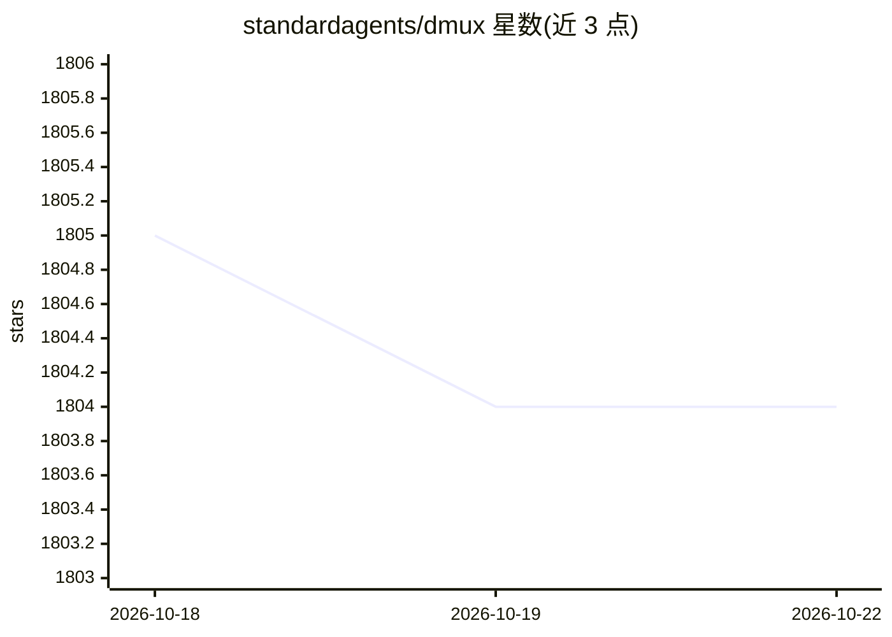

# standardagents/dmux

⭐ 1,805 · HTML · MIT · 推送 2026-08-16 · [GitHub](https://github.com/standardagents/dmux) · [官网](https://dmux.ai) · 组织维护

**用 tmux 与 git worktrees 并行管理多个 AI 编码 agent 的复用器**

面向开发者的 CLI 工具：为每个任务创建带独立 git worktree 与分支的 tmux 面板，使多个 AI 编码 agent 在隔离环境中并行工作，完成后可合并回主分支或创建 GitHub PR。支持 Claude Code、Codex、OpenCode、Gemini CLI 等 10 余种 agent CLI，并提供 AI 自动命名、可恢复终端、生命周期钩子与多项目管理。推理配置支持 API-key 提供商、OpenAI 兼容端点、Codex/ChatGPT 订阅登录或 Grok Build 登录。需 tmux 3.0+、Node.js 18+、Git 2.20+ 与至少一个 agent CLI，通过 npm 全局安装。

## 筛选速览

| 维度 | 判定 | 备注 |
|---|---|---|
| AI 角色 | `ai-ecosystem` | LLM/agent 周边工具 |
| 许可风险 | `permissive` | MIT |
| 部署形态 | `library` | 以包/库形式分发 |
| 模型依赖 | — | README 未给出锁定关系 |
| 硬件要求 | — | 无带数字的原话,不猜 |
| 安装摩擦 | `low` | 无编译、无系统依赖或容器化 |
| 成熟度 | — | 结构信号不足 |

## 能力要点

- 每个面板独立 git worktree 与分支，agent 之间工作互不冲突
- 支持 Claude Code、Codex、OpenCode、Cline、Gemini CLI 等 10 余种 agent CLI
- 一步完成 auto-commit、merge 与清理，可推送分支并创建 GitHub PR
- AI 自动命名分支/提交信息，支持多项目、生命周期钩子与面板隐藏/恢复

## 适用场景

- 让多个 AI 编码 agent 在同一仓库并行开发不同任务
- 为每个任务隔离分支与工作副本，避免 agent 之间冲突
- 任务完成后从面板菜单直接合并或发起 GitHub PR

## 场景标签

 · 领域:开发者工具/AI agent 编排

## 证据(README 行号)

> L5:  Manage multiple AI coding agents in isolated git worktrees.
> L40: - **Agent support** &mdash; Claude Code, Codex, OpenCode, Cline CLI, Gemini CLI, Qwen CLI, Amp CLI, pi CLI, Cursor 

## 星数曲线

2026-10-18 1,805 → 2026-10-22 1,804（-1）

---
*卡片 v1 · prompt 1.4 · 生成 2026-10-21 · 置信度 high · 依据 README sha `9c9346e7ec64` · [字段定义](../../DATASET.md)*
