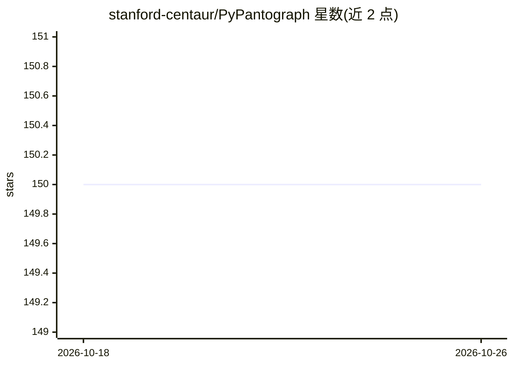

# stanford-centaur/PyPantograph

⭐ 150 · Python · Apache-2.0 · 推送 2026-10-20 · [GitHub](https://github.com/stanford-centaur/PyPantograph) · [官网](https://centaur.stanford.edu/PyPantograph/) · 组织维护

**Lean 4 的 Python 交互接口：程序化执行策略与提取数据**

提供 Python API 与 Lean 4 证明助手交互的系统：支持程序化执行 tactic、处理 metavariable 耦合、整文件规约一致性检查、提取 tactic 调用数据以及检视 Lean 常量。面向将机器学习与自动定理证明结合的研究者与开发者，底层依赖 Lean 工具链（elan）与 uv 包管理器，可通过 uv 添加为项目依赖或从源码构建 wheel。有配套论文（arXiv）。

## 筛选速览

| 维度 | 判定 | 备注 |
|---|---|---|
| AI 角色 | `ai-ecosystem` | LLM/agent 周边工具 |
| 许可风险 | `permissive` | Apache-2.0 |
| 部署形态 | `library` | 以包/库形式分发 |
| 模型依赖 | — | README 未给出锁定关系 |
| 硬件要求 | — | 无带数字的原话,不猜 |
| 安装摩擦 | `low` | 无编译、无系统依赖或容器化 |
| 成熟度 | — | 结构信号不足 |

## 能力要点

- 程序化执行 Lean tactic（goal_tactic）
- 处理 metavariable 耦合
- 整文件规约一致性检查（check_track）与 tactic 调用数据提取
- 检视 Lean 常量

## 适用场景

- 为机器学习模型提供 Lean 4 证明交互环境
- 提取 tactic 调用数据构建训练语料
- 对 Lean 文件做规约一致性检查

## 场景标签

`科研工具` · 领域:学习与行业

## 证据(README 行号)

> L5: A Machine-to-Machine Interaction System for Lean 4.
> L11: - Extraction of tactic invocation data

## 星数曲线

2026-10-18 150 → 2026-10-26 150（+0）

---
*卡片 v1 · prompt 1.4 · 生成 2026-10-22 · 置信度 mid · 依据 README sha `9e057a65e7f3` · [字段定义](../../DATASET.md)*
