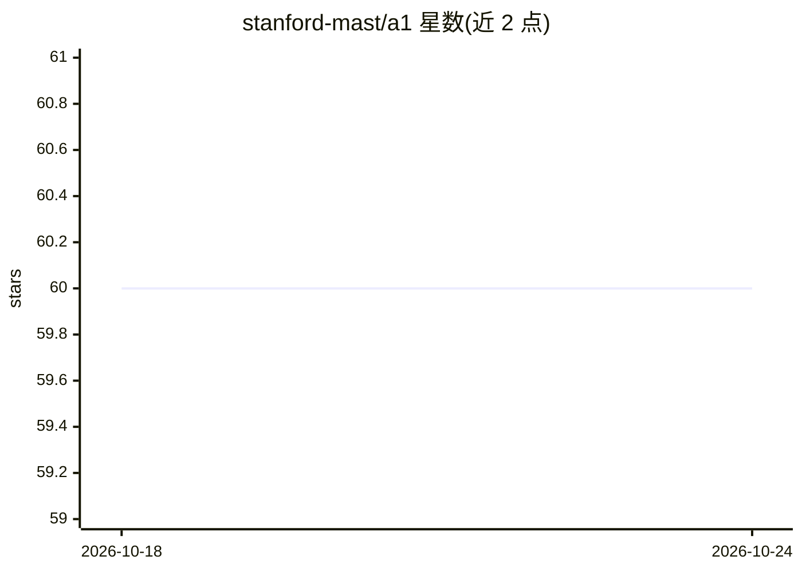

# stanford-mast/a1

⭐ 60 · Python · MIT · 推送 2026-02-23 · [GitHub](https://github.com/stanford-mast/a1) · [官网](https://a1project.org) · 组织维护

**将 Agent 编译为可执行代码的 agent 编译框架**

斯坦福 MAST 团队维护的 Python agent 编译框架：接收一个 Agent（工具集合与描述），可 AOT 预编译为 Tool 或 JIT 即时编译执行，用确定性代码尽量替换 LLM 调用。支持导入 Langchain agent、从 MCP/OpenAPI 实例化工具、基于 SQL 数据库或 fsspec 路径实例化 RAG、OpenTelemetry 可观测。自述为 Langchain/aisdk 的直接替代，API 已稳定，论文尚未发布。通过 pip 安装，MIT 许可。

## 筛选速览

| 维度 | 判定 | 备注 |
|---|---|---|
| AI 角色 | `ai-ecosystem` | LLM/agent 周边工具 |
| 许可风险 | `permissive` | MIT |
| 部署形态 | `library` | 以包/库形式分发 |
| 模型依赖 | — | README 未给出锁定关系 |
| 硬件要求 | — | 无带数字的原话,不猜 |
| 安装摩擦 | `low` | 无编译、无系统依赖或容器化 |
| 成熟度 | — | 结构信号不足 |

## 能力要点

- Agent 可 AOT 编译为 Tool 或 JIT 即时执行
- 以确定性代码最小化 LLM 调用，减少敏感数据暴露
- 支持导入 Langchain agent、MCP/OpenAPI 工具实例化
- RAG 可由任意 SQL 数据库或 fsspec 路径实例化

## 适用场景

- 延迟敏感且需与不可信数据交互的 agent 任务
- 把现有 Langchain agent 迁移到编译执行方式
- 以最小 LLM 调用量构建高确定性 agent 流程

## 场景标签

`Agent 框架` · 领域:Agent 开发

## 证据(README 行号)

> L9: A1 is a new kind of agent framework. It takes an `Agent` (a set of tools and a description) and compiles either AOT 
> L19: An agent compiler is a direct replacement for agent frameworks such as Langchain or aisdk, where you define an `Age

## 星数曲线

2026-10-18 60 → 2026-10-24 60（+0）

---
*卡片 v1 · prompt 1.4 · 生成 2026-10-24 · 置信度 high · 依据 README sha `005a4aafa0ad` · [字段定义](../../DATASET.md)*
