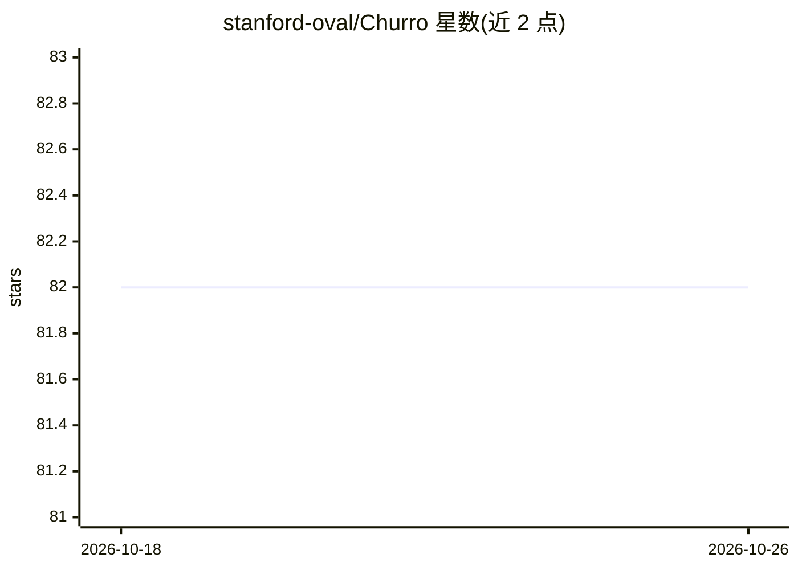

# stanford-oval/Churro

⭐ 82 · Python · Apache-2.0 · 推送 2026-04-18 · [GitHub](https://github.com/stanford-oval/Churro) · [官网](https://stanford-oval.github.io/Churro/) · 组织维护

**历史文献 OCR 工具包：把手写/印刷扫描件转成可靠文本**

面向研究者、图书馆、档案馆与产品团队的历史文档转录工具包，提供 Churro 3B 视觉语言模型（EMNLP 2025 论文）及配套数据集 Churro-DS（约 10 万页、155 个历史合集、46 个语言簇）。通过 Python API 与 CLI 将扫描件转录为文本，第一方支持自有 VLM 本地后端，并内置对 Gemini/GPT/Claude（经 LiteLLM）、vLLM/Ollama 等 OpenAI 兼容服务器、Azure Document Intelligence、PaddleOCR VL 等多种模型与后端的适配配置。安装需 Python 3.12+ 与 uv。README 中的性能表述为项目自述的基准对比结果。

## 筛选速览

| 维度 | 判定 | 备注 |
|---|---|---|
| AI 角色 | `ai-native` | 本体是模型或模型工具 |
| 许可风险 | `permissive` | Apache-2.0 |
| 部署形态 | `None` |  |
| 模型依赖 | local-ok | 支持本地模型 |
| 硬件要求 | — | 无带数字的原话,不猜 |
| 安装摩擦 | `low` | 无编译、无系统依赖或容器化 |
| 成熟度 | — | 结构信号不足 |

## 能力要点

- Churro 3B VLM 针对历史文档的转录模型，配套约 10 万页数据集
- Python API 与 CLI（churro-ocr）统一工作流
- 内置多模型/后端 profile：LiteLLM 托管 VLM、vLLM/Ollama 等 OpenAI 兼容服务器
- 覆盖 46 个语言簇，含手写与印刷体样例展示

## 适用场景

- 把档案馆的手写历史扫描页转成可检索文本
- 批量转录多语言历史文献并导出文本/Markdown
- 对比不同 OCR/VLM 后端在历史文档上的转录结果

## 场景标签

`OCR` `文档解析` · 领域:知识与检索

## 证据(README 行号)

> L13: Churro is the fastest way to turn hard-to-read historical scans into reliable text. It gives researchers, libraries
> L40: churro-ocr transcribe --image scan.png --backend hf --model stanford-oval/churro-3B

## 星数曲线

2026-10-18 82 → 2026-10-26 82（+0）

---
*卡片 v1 · prompt 1.4 · 生成 2026-10-24 · 置信度 high · 依据 README sha `7a4ab01fb692` · [字段定义](../../DATASET.md)*
