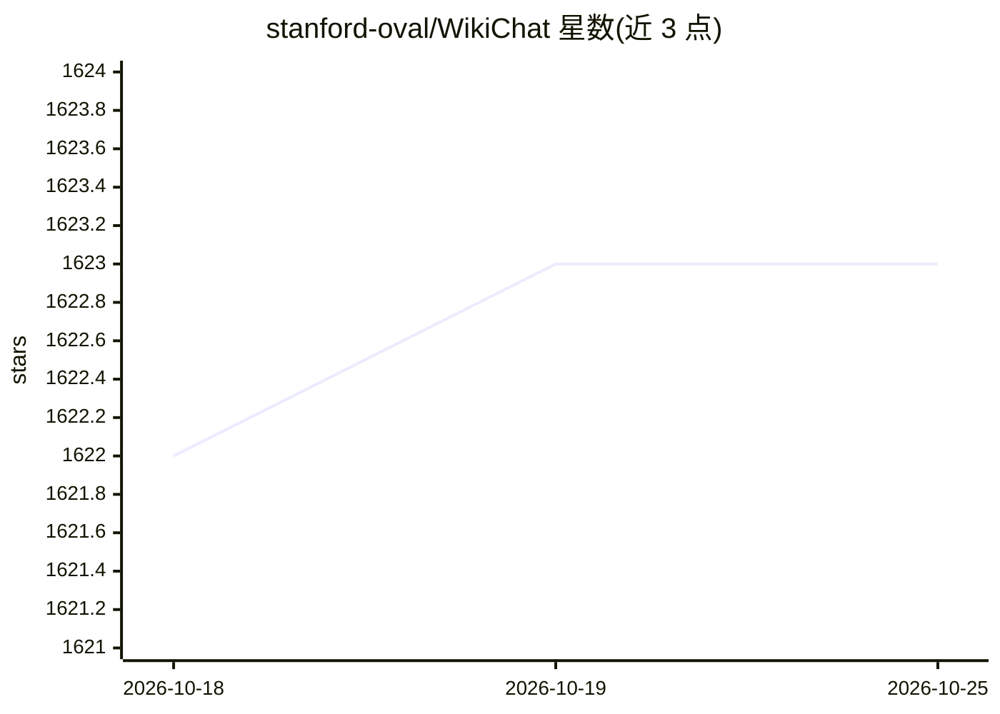

# stanford-oval/WikiChat

⭐ 1,622 · Python · Apache-2.0 · 推送 2026-01-31 · [GitHub](https://github.com/stanford-oval/WikiChat) · [官网](https://wikichat.genie.stanford.edu) · 组织维护

**基于 Wikipedia 检索的减少 LLM 幻觉对话系统**

Stanford Oval 开发的 RAG 聊天机器人：通过 7 阶段流水线（检索、证据提取、声明生成与验证等，每阶段含 LLM 调用）将回答锚定在 Wikipedia 上，以减少大模型幻觉，并在最终回答中加入行内引用。默认使用其免费限流的多语言 Wikipedia 检索 API（25 种语言），也可自建或自定索引；经 LiteLLM 支持 100+ LLM，兼容本地模型与 LangChain。安装依赖 pixi、Docker（Qdrant/TEI 向量库）与 Redis；本地建索引或本地 LLM 需 GPU。

## 筛选速览

| 维度 | 判定 | 备注 |
|---|---|---|
| AI 角色 | `ai-native` | 本体是模型或模型工具 |
| 许可风险 | `permissive` | Apache-2.0 |
| 部署形态 | `None` |  |
| 模型依赖 | — | README 未给出锁定关系 |
| 硬件要求 | — | 无带数字的原话,不猜 |
| 安装摩擦 | `low` | 无编译、无系统依赖或容器化 |
| 成熟度 | — | 结构信号不足 |

## 能力要点

- 7 阶段流水线将回答锚定 Wikipedia，输出含行内引用
- 支持 25 种语言 Wikipedia 检索，默认免费限流 API，可自建/自定义索引
- 经 LiteLLM 兼容 100+ LLM，支持本地 HuggingFace 模型与 OpenAI 兼容端点
- 可索引自定义 JSONL 文档，使用 Qdrant 向量检索与 Arctic/BGE-M3 嵌入

## 适用场景

- 需要事实性与带引用的开放域问答对话
- 用自有文档集合构建可溯源的知识问答
- 多语言（25 种 Wikipedia）事实性问答

## 场景标签

`聊天机器人` `RAG` `文档问答` · 领域:对话与助手

## 证据(README 行号)

> L26: WikiChat uses Wikipedia and the following 7-stage pipeline to makes sure its responses are factual. Each numbered s
> L72: 1. Configure the LLM of your choice. WikiChat supports over 100 LLMs, including models from OpenAI, Azure, Anthropi

## 星数曲线

2026-10-18 1,622 → 2026-10-25 1,623（+1）

---
*卡片 v1 · prompt 1.4 · 生成 2026-10-21 · 置信度 high · 依据 README sha `13da14a6c2be` · [字段定义](../../DATASET.md)*
