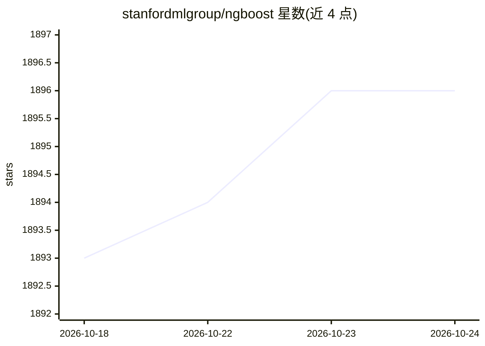

# stanfordmlgroup/ngboost

⭐ 1,896 · Jupyter Notebook · Apache-2.0 · 推送 2026-10-08 · [GitHub](https://github.com/stanfordmlgroup/ngboost) · 组织维护

**不确定性预测的梯度提升 Python 库：输出概率分布**

NGBoost 是实现自然梯度提升（Natural Gradient Boosting）的 Python 库，用于概率预测：回归与分类时输出完整概率分布而非点估计，以 proper scoring rule 训练。构建在 Scikit-Learn 之上，在评分规则、分布和基学习器三个维度模块化可替换，用户指南说明如何添加新分布与分数。由斯坦福团队维护，配有论文与方法讲义，Apache 2.0 许可。

## 筛选速览

| 维度 | 判定 | 备注 |
|---|---|---|
| AI 角色 | `ai-native` | 本体是模型或模型工具 |
| 许可风险 | `permissive` | Apache-2.0 |
| 部署形态 | `library` | 以包/库形式分发 |
| 模型依赖 | — | README 未给出锁定关系 |
| 硬件要求 | — | 无带数字的原话,不猜 |
| 安装摩擦 | `low` | 无编译、无系统依赖或容器化 |
| 成熟度 | — | 结构信号不足 |

## 能力要点

- 自然梯度提升算法实现，输出概率预测（不确定性估计）
- 基于 Scikit-Learn 构建，API 与 sklearn 风格一致
- 评分规则、分布、基学习器均可模块化替换

## 适用场景

- 回归任务中同时获得预测值与置信区间
- 需要不确定性量化的机器学习建模
- 在 Scikit-Learn 工作流中引入概率预测

## 场景标签

 · 领域:机器学习/统计建模

## 证据(README 行号)

> L10: ngboost is a Python library that implements Natural Gradient Boosting, as described in "NGBoost: Natural Gradient B
> L38: Tony Duan, Anand Avati, Daisy Yi Ding, Khanh K. Thai, Sanjay Basu, Andrew Y. Ng, Alejandro Schuler. 2019.

## 星数曲线

2026-10-18 1,893 → 2026-10-24 1,896（+3）

---
*卡片 v1 · prompt 1.4 · 生成 2026-10-21 · 置信度 high · 依据 README sha `778cf7c9e3c2` · [字段定义](../../DATASET.md)*
