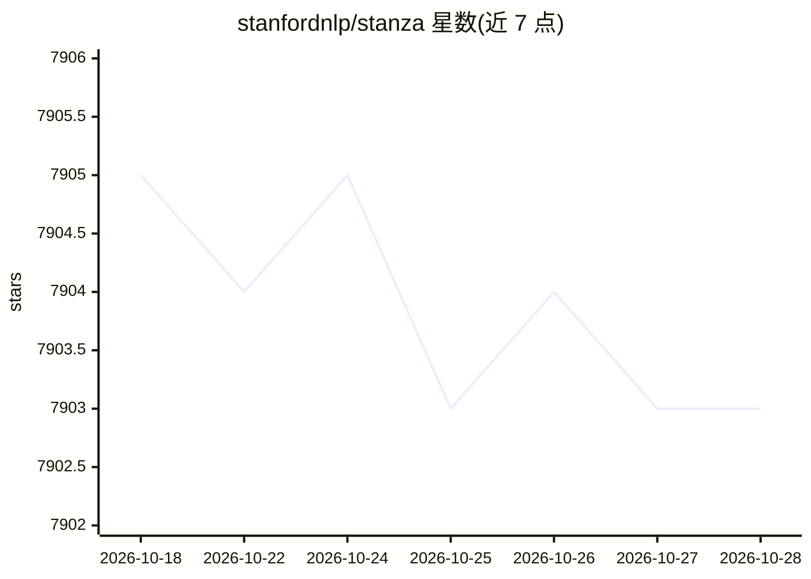

# stanfordnlp/stanza

⭐ 7,904 · Python · NOASSERTION · 推送 2026-10-28 · [GitHub](https://github.com/stanfordnlp/stanza) · [官网](https://stanfordnlp.github.io/stanza/) · 组织维护

**面向 60+ 语言的多语言 NLP 工具库：分词、命名实体识别、句法分析**

斯坦福 NLP 组的官方 Python 库，基于 PyTorch 神经网络管线，支持 60+ 种人类语言的分词、句子切分、词性标注、引理还原、依存句法分析与命名实体识别，另提供从 Python 访问 Java Stanford CoreNLP 的官方封装（需设置 CORENLP_HOME）。提供通用依存树库 v2.8 全量预训练模型与生物医学/临床英文模型包；各神经模块可用自有 CoNLL-U/BIOES 数据训练，但训练不支持 Pipeline 接口，需从源码运行。通过 pip、conda 或源码安装。

## 筛选速览

| 维度 | 判定 | 备注 |
|---|---|---|
| AI 角色 | `ai-native` | 本体是模型或模型工具 |
| 许可风险 | `none` | NOASSERTION |
| 部署形态 | `library` | 以包/库形式分发 |
| 模型依赖 | — | README 未给出锁定关系 |
| 硬件要求 | — | 无带数字的原话,不猜 |
| 安装摩擦 | `low` | 无编译、无系统依赖或容器化 |
| 成熟度 | — | 结构信号不足 |

## 能力要点

- 60+ 语言的神经 NLP 管线（分词/词性/依存分析/NER）
- Python 访问 Java Stanford CoreNLP 的官方封装
- 生物医学与临床英文模型包
- 支持用自有 CoNLL-U/BIOES 数据训练各神经模块

## 适用场景

- 多语言文本做分词与依存句法分析
- 从生物医学文献与临床笔记中抽取命名实体
- 在 Python 中调用 Stanford CoreNLP 的标注功能

## 场景标签

 · 领域:自然语言处理

## 证据(README 行号)

> L16: The Stanford NLP Group's official Python NLP library. It contains support for running various accurate natural lang
> L106: >>> nlp = stanza.Pipeline('en') # This sets up a default neural pipeline in English

## 星数曲线

2026-10-18 7,905 → 2026-10-28 7,903（-2）

---
*卡片 v1 · prompt 1.4 · 生成 2026-10-20 · 置信度 high · 依据 README sha `142051a8ebbc` · [字段定义](../../DATASET.md)*
